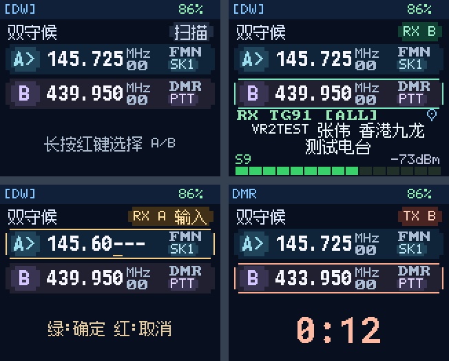
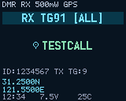
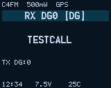
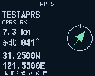
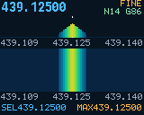

# OpenGD77-DIGIALL — Public firmware testing

[公测网站与刷机助手 / Test site and flash guide](https://xunyu5800-alt.github.io/OpenGD77-DIGIALL-Testing/) · [机型验收表 / Acceptance matrix](docs/TEST_MATRIX.md) · [提交测试反馈 / Report a test](https://github.com/xunyu5800-alt/OpenGD77-DIGIALL-Testing/issues/new?template=firmware-test.yml)

**rc.16 多机型公测**。六套 DIGIALL 板型和十一套上游原版对照包已按型号整理。C4FM 增加 SK1 一键切换 0／+300 Hz 的频偏预置。 [下载](https://github.com/xunyu5800-alt/OpenGD77-DIGIALL-Testing/releases/tag/v1.2.0-rc.16) · [按机型选包及复测说明](docs/MULTI_MODEL_TESTING.zh-CN.md)

**Free, non-commercial, unofficial community firmware.** Binary releases, guides and feedback only. The firmware source repository and development history remain private; do not describe this repository as the firmware source or as OSI-licensed open source.

[Download v1.2.0-rc.15](https://github.com/xunyu5800-alt/OpenGD77-DIGIALL-Testing/releases/tag/v1.2.0-rc.15) · [新手入门与完整手册](https://github.com/xunyu5800-alt/OpenGD77-DIGIALL-Testing/blob/main/docs/MANUAL.zh-CN.md) · [PDF](https://github.com/xunyu5800-alt/OpenGD77-DIGIALL-Testing/releases/download/v1.2.0-rc.15/OpenGD77_DIGIALL_Manual_ZH_CN_v1.2.0-rc.15.pdf) · [English guide](docs/USAGE.en.md) · [中文使用说明](docs/USAGE.zh-CN.md) · [刷机教程与 Windows 向导](docs/FLASH_WIZARD.zh-CN.md)

**Release credit · VRWZI / BIAOQ**

**rc.15** adds a redesigned FM/DMR dual-watch screen and separate transmit keys. Hold SK1 for A, or hold physical PTT for B. [Release notes](docs/releases/v1.2.0-rc.15.md) · [Dual-watch controls](docs/SCAN_RECORDING.en.md)

## Who can test

The rc.16 collection includes six DIGIALL board profiles and eleven original OpenGD77 reference packages. Confirm the exact board revision, make CPS backups and keep a known recovery procedure. Start with the boot, display, keypad, FM and DMR checks. C4FM transmit is disabled in the DIGIALL DM-1701 and RT-84 builds. [Model selection and installation](docs/MULTI_MODEL_TESTING.en.md)

Existing project font/pinyin: matching03 only. First install/R250326 resources: matching01→02→03, waiting for each writer's verified completion and power-off. Back up calibration/codeplug/records. Public packages do not contain AMBE codecs or donors; applicable codec rights are required. Do not upload a donor or merged firmware to Issues.

All packages support FM and DMR TX/RX. If a channel says RX Only during PTT, check Channel Details → RX Only and the installed Stage 03 profile. [Troubleshooting](docs/USAGE.en.md#1-hardware-and-package-selection)

## What needs feedback

DMR ALL/selected-TG isolation and live group switching; C4FM DN PTT, voice clarity, return to RX and GPS on each 10W board with a DN receiver or MMDVM/Pi-Star; split frequencies and rooms; APRS/position pins/compass; Chinese input, waterfall and FM recorder behaviour. Record hardware, exact package, mode, expected/actual result and repeatable steps. Power labels are not measurements; qualify BER conditions. No blanket RF/audio/10W-TX acceptance is claimed.

This development used AI assistance with operator-led hardware testing. The maintainer is seeking independent verification, not claiming AI output alone proves correctness.

## Interface examples

These are production-function/font reconstructions using synthetic identities/positions, **not radio photographs**.

[Light theme](docs/screenshots/dual-watch-rc15-light.png)

| DMR position indicator | C4FM operating view |
| --- | --- |
|  |  |
| APRS compass | Waterfall scan |
|  |  |

## 中文

这是公开测试发布仓库，仅包含固件、说明、许可、致谢、示例图与反馈入口。**原源码及提交历史仍保持私有**。免费非商业，不收费、不代表官方背书；各组件保留独立许可。rc.15 包适用于双段 MD-UV380／MD-UV390。rc.16 的新增机型及功能范围以页面顶部的选包表为准。先备份和核对板卡，再按使用说明安装，已有资源只刷03。

**本版署名 · VRWZI／BIAOQ**

**rc.15** 更新 FM／DMR 双守候主屏。长按 SK1 发 A，实体 PTT 发 B。欢迎复测调频后恢复守听、按键分路和深浅主题的可读性。[发布说明](docs/releases/v1.2.0-rc.15.md) · [双守候按键](docs/SCAN_RECORDING.zh-CN.md)

欢迎反馈DMR组过滤／切组、两种 10W 的 C4FM 发射、语音、松键回接收和 GPS、异频／房间、APRS与指南针、中文输入、瀑布图和FM录音。提交Issue时填机型、版本、复现步骤、期望／实际行为，不上传密码、donor、他人录音或私人精确位置。

[Non-commercial distribution / 发布声明](DISTRIBUTION.md) · [Credits / 呼号致谢](ACKNOWLEDGEMENTS.md) · [Component notices / 第三方许可](THIRD_PARTY_NOTICES.md)
