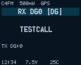
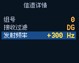

# Daily C4FM operation: v1.2.0-rc.5

[中文](C4FM_OPERATING.zh-CN.md) · [Versions/downloads](VERSIONS.md)

This release brings the user-confirmed local-YSF2DMR D22/INV/G4/N2/E1 RF baseline to the ordinary5W main screen. Staying in4:MIC is no longer required. RX retains the user-confirmed C6000 RAM path; waveform, codec interfaces and fault cutoffs are retained. Main rendering shares DMR caller paging/band/meter/footer; settings use the original channel-details menu. The new main UI, independent trim and newly exposed higher power levels still need hardware acceptance; success with the earlier panel does not validate those additions.

## Hardware and installation

- Ordinary dual-band MD-UV380/MD-UV390 **5W+GPS**: C4FM DN RX and main-screen PTT.
- Both10W Plus backlight layouts: matching FM/DMR/Chinese packages; C4FM remains RX-only. The5W TX driver is not applied to10W.
- Existing project font/pinyin: matching03 only. First installation/oldR250326 resources: matching01font→02pinyin→03main. Preserve calibration; use your lawful CPS donor. Public firmware contains no proprietary AMBE.

## Main-screen controls

| Gesture | C4FM action |
| --- | --- |
| SK2+short* | Cycle FM→DMR→C4FM→FM |
| Hold/release physical PTT | Send DN / bounded terminator and RX restoration |
| Hold GREEN on main screen | Remote position, distance, bearing and north-up compass; RED returns; no auto-popup. [Details](RECEIVED_POSITION.en.md) |
| Front UP/DOWN | Select DG-ID0–127 and selected-DG RX; distinct from rotary |
| SK2+UP/DOWN | Original DMR power steps, global/per-channel overrides and calibration |
| SK2+longUP | Original user-configured +W selection |
| Rotary | Original channel/VFO tuning; does not change DG |
| Short* | Enter DG-ID0–127; GREEN confirms, RED cancels, * deletes |
| ShortSK1 or longSK2 | Temporary all-DG search on/off; TX destination unchanged |
| LongSK1 | Save ALL/selected-DG filtering |
| Short# or SK2+# | Rooms: no TX merely opening; #query, five digits+GREEN connect, long*disconnect |
| SK2+GREEN or long* | Shared channel details: rotary selects items, frontUP/DOWN edits, GREEN saves, RED cancels; adds DG/filter/TX trim |
| SK1+short# | Main/RX diagnostics/health; diagnostics7/9 adjust playback gain, GREEN switches RAM/I2S |
| Long# | Retained advanced test panel |

C4FM selection, DG, filter and TX trim persist in existing spare settings word2. Settings size and codeplug format are unchanged; five-tone word1 is untouched. Temporary search is not saved. Retuning/re-entering an analog channel/VFO restores selected C4FM; real DMR channels remain DMR. Explicitly cycling C4FM to FM clears its selection.

PTT retains lock/menu/RX-only/band/tuning/codec checks and requires a fresh physical press, without VOX/latch auto-keying. Main PTT uses channel TOT or a60s fallback when TOT=0. E1 release is bounded to400ms without extending TOT; faults/emergency/sample/SPI/range failures cut immediately. Diagnostic PTT remains at60s/shorterTOT, green-key probes at2s.

## Shared DMR power ladder

50/250/500/750mW,1/2/3/4/5W and original user-configured +W use the same settings, channel overrides and factory/user calibration. +W has no assumed wattage: USB reports custom_power instead of a fictitious0mW. Selecting power never transmits or forces500mW into global defaults. Start acceptance at the previously used500mW; actual RF power/long operation at new levels remain unmeasured.

## Keep a common hotspot RXOffset

Hotspot RXOffset shifts the common RF receive center. If-300 breaks DMR wake-up, restore its working value (0 in this comparison). Upstream [Modem code](https://github.com/g4klx/MMDVM-Host/blob/94d81993023fe26a56fd4960fd0f94f4c024b31b/Modem.cpp) adds it to the shared RX frequency.

New **C4FM-only TX trim** defaults0, range±1500Hz in100Hz steps. Positive raises actual C4FM TX frequency; negative lowers it. Codeplug, FM/DMR TX, RX and factory calibration remain unchanged. This adjusts center frequency, separately from D22 amplitude.

1. Restore hotspotRXOffset0 and confirm original DMR operation.
2. SK2+GREEN (or long*) opens the same channel-details menu as DMR. Rotate to the final TX trim item, edit in100Hz steps with frontUP/DOWN, try **+300Hz**, GREEN saves. Earlier-300 lowered the hotspot center; raising radio TX is a comparison direction, **not established calibration**. Judge by measured results.
3. Retain D22/INV/G4/N2/E1,500mW, position and LowDeviation0. Test main PTT BER/Hoseline. Restore0 if not improved; do not simultaneously change hotspot offset, power or deviation.
4. Switch back to DMR and verify its original tuning. `--tx-status-only` distinguishes configured_tx_hz/effective_tx_hz/c4fm_tx_trim_hz; diagnostic counters are not RF measurements.

## Confirmed network route

Local Pi-Star: enableYSF/YSF2DMR, Apply in ordinary Configuration, then find Yaesu System Fusion Configuration. Choose **00002/Link YSF2DMR**, configure target-network master, your DMR ID, Hotspot Security and DMR TG460501. StartupPC defaults0 only when absent; verify an existing value separately. There is no standalone Expert→YSF2DMR editor. See [configuration/route checks](C4FM_NETWORK_ECHO.en.md).

The user reports the local-bridge comparison succeeded and requested freezing this RF baseline. Earlier46572 remote bridging passed phone→radio but produced no reverse Hoseline call; it is a different route. DG0 is not DMR TG460501: DG stepping does not change the bridge TG, and the five-digit room page cannot accept a six-digit DMR TG. Do not reconnect46572 during the local-bridge test.

Private IQ/speech/raw logs/donor are excluded. Tests; exact source/binary hashes are in the Release manifest.

C4FM and DMR share the digital caller renderer, native compact Chinese paging, group band, meter/footer and position rows. Configuration reuses the original channel-details save/cancel transaction. Appended C4FM items preserve existing QuickKey indices. CC/TS remain DMR-specific; FM-only CSS/bandwidth controls are unavailable in C4FM rather than inventing protocol equivalents.
