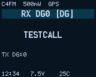
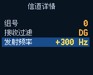

# C4FM日常收发：v1.2.0-rc.6

[English](C4FM_OPERATING.en.md) · [版本与下载](VERSIONS.md)

本版把已经由用户确认可通过本机YSF2DMR通联的D22／INV／G4／N2／E1链路接入普通5W主屏。它不再要求停留在4:MIC测试面板。接收继续默认使用清晰度已确认的C6000 RAM路径，原调制波形、声码器接口和故障停发保护保留。主屏与DMR共用呼号分页、组号栏、信号表与底栏，设置使用原信道详情。新主屏、独立微调及新增高功率档位仍需刷机后验证，不能把旧测试面板的成功当作这些新功能已经上机验收。

## 机型和安装

- 普通双段MD-UV380／MD-UV390 **5W＋GPS**：C4FM DN接收和主屏PTT发射。
- 10W Plus两种背光布局：提供对应FM／DMR／中文功能包，C4FM仍为接收；本版没有把5W发射驱动套用到10W。
- 已有本项目中文字库和拼音只刷对应03。首次安装或旧R250326资源按同一硬件的01字库→02拼音→03主固件；不要覆盖校准。公开固件不含专有AMBE，沿用自己的合法CPS donor合入。

## 主屏按键

| 操作 | C4FM行为 |
| --- | --- |
| SK2＋短按* | FM→DMR→C4FM→FM |
| 按住实体PTT／松开 | 主屏发送DN语音／发送受限结束帧并恢复接收 |
| 主屏长按绿键 | 打开对方位置、距离、方位角和北向指南针；红键返回；不自动跳页。详见[位置页](RECEIVED_POSITION.zh-CN.md) |
| 机身上下键 | 选择DG-ID 0～127，切换后收听指定DG；旋钮不用于这个操作 |
| SK2＋上下 | 原DMR功率加减，沿用全局或当前信道功率覆盖与校准表 |
| SK2＋长按上 | 沿用原有＋W用户功率选择 |
| 旋钮 | 原信道切换／VFO调频；不会改DG-ID |
| 短按* | 输入DG-ID，0～127；绿键确认、红键取消、*退格 |
| 短按SK1或长按SK2 | 临时搜索／放行所有DG，再按退出；发射DG保持原选择 |
| 长按SK1 | 切换并保存ALL／指定DG过滤 |
| 短按#，或SK2＋# | 房间页；打开页面不会发射，#查询、五位数字＋绿键连接、长*断开 |
| SK2＋绿键，或长按* | 原信道详情：旋钮选项、机身上下调值、绿键保存、红键取消；C4FM新增组号／接收过滤／发射频率（偏移） |
| SK1＋#、长按# | 发布版不打开诊断或高级测试面板；长按#也不启动反频／VFO扫描 |

持续按住 SK2 只执行一次临时 DG 搜索切换，不再进入 DMR／FM 自动检测监听。DMR 和普通 FM 的原监听操作保留。高级诊断入口只存在于显式 `--ysf-tx-test` 开发构建。

## 从 DMR／C4FM 发送 APRS

本机 APRS 使用 **FM 的 1200 波特 AFSK**，不直接通过 DMR／C4FM 语音链路发送。先切换到 CPS 中关联 APRS 配置的 FM 信道，确认当地 APRS 收发频率及接收专用／频段限制。位置信标：将“APRS 选项 → 模式”设为手动，取得 GPS 定位或有效信道保存坐标后，在主屏 **按住 SK1＋2**。文本消息：进入 **APRS 发送**，填入对方呼号、正文后按绿键；发送成功后再手动回原数字信道。

保持在 DMR／C4FM 或开启 APRS 优先守候时，发送请求被拒绝并显示 `APRS: FM`；优先守候只接收，不能借临时频率发射。DMR GPS／C4FM 位置数据也不等同于 APRS 上网，转发需要相应网络网关。

C4FM模式选择、DG-ID、ALL／指定过滤和TX微调保存在原设置的空闲字2，设置长度与码表格式不变，五音使用的空闲字1不动。临时搜索不保存。普通模拟信道／VFO重新配置后会恢复所选C4FM覆盖；真正的DMR信道仍使用DMR。退出C4FM到FM会清除C4FM选择。

PTT仍受PTT锁、页面上下文、接收专用信道、频段限制、实际收发配置与声码器可用性检查。必须重新按下实体PTT才可开始；VOX／PTT锁存不自动发射。主屏使用信道TOT；TOT为0时回退60秒。松键E1最多400ms且不延长TOT，故障、紧急停止、采样／SPI／频率越界立即停发。诊断面板仍限60秒或更短TOT，绿键固定探测仍限2秒。

## 功率与DMR共用

50／250／500／750mW、1／2／3／4／5W，以及原有＋W用户配置，采用同一组设置、每信道覆盖和工厂／用户校准。＋W不是测量出的瓦数，USB工具会将其标为custom_power而非捏造0mW。切换功率不发射，也不把500mW强制写成全局默认。首次复测请主动选择之前用过的500mW；新增档位的实际RF功率和长时间运行尚未测量。

## 让DMR和C4FM共用热点RXOffset

热点RXOffset是共用RF中心修正，−300若使DMR唤醒超时，应恢复到DMR原来正常的值（本机对照为0）。不能把YSF的最佳接收点永久套给所有模式。上游[Modem实现](https://github.com/g4klx/MMDVM-Host/blob/94d81993023fe26a56fd4960fd0f94f4c024b31b/Modem.cpp)把RXOffset加在共用接收频率上。

本版新增**仅C4FM TX微调**，默认0，范围−1500～＋1500Hz、100Hz一步。正值提高C4FM实际发射频率，负值降低；不改码表频率、FM／DMR发射、接收频率或工厂校准。它用于中心频率，不是D22调制幅度。

1. 热点先恢复DMR可用的RXOffset=0，确认原DMR可用。
2. 手台SK2＋绿键（或长按*）进入与DMR相同的信道详情，旋钮选到末尾“发射频率”，机身上下以100Hz调值，可先试**＋300Hz**，绿键保存。因为原热点−300使接收中心降低，向上移手台发射是一个待验证的对照方向，**不是已测定的校准值**；是否改善以实测为准。
3. 保持D22／INV／G4／N2／E1、500mW、位置及热点LowDeviation=0不变，用主屏PTT复测BER和Hoseline语音。无改善先回0；不要同时改热点偏移、功率或D档。
4. 切回DMR再测试，原频率应保持。工具`--tx-status-only`分别显示configured_tx_hz、effective_tx_hz、c4fm_tx_trim_hz，便于核对；计数不等于RF实测。

## 当前已经打通的网络路线

本机Pi-Star：YSF／YSF2DMR开启，普通Configuration里先Apply再找Yaesu System Fusion Configuration；YSF Startup Host选**00002／Link YSF2DMR**，目标网络主站、本人DMR ID、Hotspot Security和DMR TG=460501在该区域配置。StartupPC缺省0；若已有值则另行核对。没有独立Expert→YSF2DMR编辑页。详见[配置入口与桥接排查](C4FM_NETWORK_ECHO.zh-CN.md)。

用户已报告本机桥对照成功，要求冻结已用链路。此前46572远端桥“手机→手台”可用而反向Hoseline无来话，不再把它当作本机桥同一路线。DG0不是DMR TG460501；上下切DG不会自动修改DMR目标组，五位房间页也不能输入六位DMR TG。测试本机桥时不要再连接46572。

公开包不包含私人IQ、录音、原始日志或donor。软件检查与编译验证见测试说明，具体二进制哈希和源码提交见Release清单。

主屏与DMR共用数字来话绘制函数、原生中文紧凑分页、组号条、信号表与底栏；主屏仅显示位置图钉，长按绿键查看坐标。设置复用原信道详情及保存／取消事务，C4FM字段追加在末尾，保留原QuickKey编号。CC／TS只属于DMR；C4FM的模拟亚音、带宽等不适用项显示不可用，不伪造这些协议参数。
