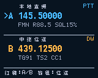
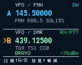
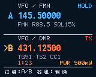
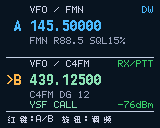
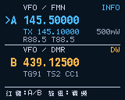

# 可交互双守

双守使用一套接收机轮询 A/B。上下两个区固定对应 A、B；A 的频率和标识为蓝色，B 为橙色，`>A`／`>B` 箭头和 `PTT` 标出当前操作与发射侧（与绿色 `RX` 接收侧分别标识）。普通按键不再结束双守。本版实体 PTT 跟随选中侧，替换 rc.15 的 SK1=A／PTT=B 映射，SK1 用于详情。

## 显示重点

| 状态 | 对应一侧显示 |
| --- | --- |
| 守候 | 名称、大字频率，以及精简的 FM 亚音/静噪或 DMR TG/TS/CC；选中侧标记 PTT |
| 接收 | 绿色 RX；频率保持大字，下面显示有效来话人、实际 TG/TS/CC 和信号强度；接收不会自动移动操作侧 |
| 发射 | 红色 TX、大字发射频率、发射目标或亚音、功率和计时；另一侧标记 HOLD |

160×128 屏幕的文字距左右、顶部至少 6 像素，底部至少 5 像素。固定底栏提示“红键:A/B 旋钮:调频”（信道模式为“旋钮:信道”），避免将操作藏在文档中。布局参考 [RadioFoundry MD-UV380 图库](https://radiofoundry.org/zh/screenshots/#mduv380) 的分区、独立 PTT/RX 标识和底部操作提示。
时钟、温度、重复的收发频率和静止时的历史来话不占用双守主屏。进入频率输入后，操作侧显示正在输入的数字；选择 TX 频率时用 T 前缀和 TX 参数提示。

## 操作

- **启动**：VFO 快捷菜单 → 双守候；或在信道快捷菜单的“双守候”中左右选择 B，绿键启动，当前信道为 A。
- **切换操作侧**：短按红键。频率/信道、静噪、TG、时隙、功率和设置均作用于操作侧。输入中的红键沿用输入取消/退格行为。
- **调频／换信道**：先短按红键选中 A 或 B，再转动信道旋钮；VFO 按当前步进调频，信道模式切换频道。VFO 也可直接输入 8 位频率，如 `14550000` 对应 145.50000 MHz；红键取消未完成输入。SK2＋旋钮向上选择 RX 频率编辑，向下选择 TX，选中 TX 时显示 `SET TX` 和 `T` 前缀。
- **切换协议**：选中 A 或 B 后，短按 SK2＋星号，在 FM → DMR → C4FM → FM 之间循环，只改变当前侧。模式提交后统一刷新分屏，普通模式界面不插入绘制。
- **SK1 详情**：按住 SK1，在当前侧显示 RX／TX 频率、功率和协议参数，松开恢复；另一侧保留显示。C4FM 下短 SK1 也用于这一详情查看，搜索用长按 SK2，DG-ID 用前面板上下键调整，星号进入数字编辑、绿键保存、红键取消。数字编辑期间不轮询切走。
- **设置**：绿键进入主菜单，SK2＋绿键进入当前侧信道详情，橙键进入快捷菜单。菜单暂时使用全屏，返回后恢复分屏及轮询。
- **连续调整**：轮询在操作时暂缓，输入完成且按键/语音提示空闲约 800ms 后恢复。频率尚未输入完成或监控键仍按住时保持在操作侧。
- **发射**：一次按下 PTT 即在操作侧发射，其他侧暂缓接收；松开并返回主屏后自动恢复双守。
- **退出**：长按红键，或在快捷菜单再次确认“双守候”。普通扫描的 STOP 设置不会结束双守。要使用独立的扫频/亚音扫描，请先退出双守。

两侧分别保留当前 TG、TS 覆盖、功率、过滤、信道数据和接收记录。信道模式可以分别在区域中选频道；切换区域或排序不会把另一侧换成同一位置的其他信道。保存到 CPS 沿用原有信道详情保存规则。双守期间关闭接收节电，退出后恢复设置。

双守支持 FM、DMR 和 C4FM DN 混合轮询。A/B 分别保留 C4FM 选择、DG-ID、过滤设置与 TX 频偏；调谐前释放旧 PCM/DMA，加载当前侧后恢复对应解码器。C4FM 无来话时驻留至少 700ms，仅解码到 DN 来话后延长接收，普通 FM 载波不冒充 C4FM 来话。单接收机不能同时接收两侧，C4FM 的较长驻留会拉长另一侧的等待时间，短呼叫可能漏收。C4FM 发射能力仍取决于原有硬件配置（5W、两种 10W 和 RT-3S 支持主 PTT；DM-1701／RT-84 从 rc.19 起也启用主 PTT，六种板型均编入 C4FM 收发，待真机验证）。

PTT 在选中的一侧发射，与按键时 RF 正在轮询哪一侧无关。先恢复这一侧的模式与频率，再选择 FM／DMR 或 C4FM 发射控制器；松开自动恢复轮询。APRS 的 PTT／自动信标只在适用的 FM 模式尝试发送，DMR／C4FM 不再因自动追加信标弹出 `APRS: FM`。显式手动发送 APRS 的模式检查仍保留。

收到已解码的 APRS 位置包时，双守会显示 5 秒位置卡片，即使接收机随后轮询到另一侧的 DMR／C4FM，也不会丢掉提示。弹窗暂时暂停轮询，超时或按红键关闭后恢复原双守，保留 A/B 配置和选中的 PTT 侧。按键操作、频率输入、详情设置、锁定、发射和录音回放期间延后提示；10 秒内仍无法显示则过期。其他台站随后发来的非位置报文不会清除或替换排队中的位置卡片。

## 源码预览与验证

DM-1701 的有效绘图区为 160×120，双守使用完整双栏信息并压缩垂直行距，保留频率、来话/TG 和底部操作提示；不能按 128 行屏幕直接放置最底部文本。

下列图片由生产绘图函数和字体生成，频率、姓名和计时是合成数据，不是真机照片。

| 守候 | B 收到来话 | B 发射 |
| --- | --- | --- |
|  |  |  |

| B 接收 C4FM | 按住 SK1 查看 A |
| --- | --- |
|  |  |

`python3 tests/run_dual_watch_tests.py`（Linux/WSL、GCC、ASan/UBSan）直接编译生产会话、按键分派、轮询、菜单返回和绘图代码，覆盖 1000 次不保存中间选择的轮询、独立修改、区域切换、TS/功率隔离、菜单/PTT 返回、输入保持、STOP 设置、真实来话目标、输入与调频提示、PTT/RX 区分、文字安全边距、三协议循环、C4FM 轮询／DG-ID 隔离、SK1 按下／松开和两种屏幕尺寸边界。`python tools/ui-atlas/render_dual_watch.py` 重建预览。

软件测试不替代真机 LCD 和空口验证。重点复测两侧分别收到信号、操作期间不退出、不同区域/不同 TG、菜单保存与取消、按 PTT 的实际频率、松 PTT 自动恢复、锁屏返回及节电恢复。
