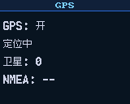
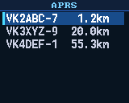
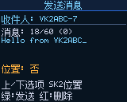
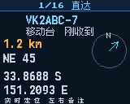
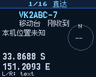

# GPS 默认开启与 APRS 接收

本说明适用于 rc.8 带 GPS 支持的双段 MD‑UV380／MD‑UV390。

## GPS 如何开启

- 新装、恢复默认设置：GPS 模块默认开启。
- 从早期固件首次升级：把“未检测/关闭”改为开启一次；已有 NMEA 等开启模式保留。
- 此后在“设置 → 常规选项 → GPS”手动关闭并保存，会保留选择，重启不会强制开启。
- “菜单 → GPS”查看卫星和定位。首次定位请在开阔室外等待；开启模块不等于已取得坐标。无 GPS 硬件不能通过固件获得定位。

**GPS 模块开启与 GPS 写 Flash 轨迹是两件事。** 本发布版继续关闭 Flash 轨迹记录，保留录音空间；外部 Flash 最后 512KiB 仍供中文字库与拼音表使用。

下面是源码重建的状态说明图，使用示例数据，**并非真机截图或定位成功的证明**：

## APRS 是后台守听吗

**解码任务在后台运行，但必须接收到对应频率的 FM 信号。** 不必停留在 APRS 接收页面；查看主屏、GPS 或其他菜单时，当前 FM 接收音频仍可送给 APRS 解码器。

**默认自动监听 CPS 对应频率。** 在 CPS 建立当地 APRS FM 信道并关联有效的 1200 波特 APRS 配置。切到该信道，或普通 FM 信道／VFO 调到相同的实际接收频率，就自动保持音频采集与后台解码，不需要打开日志或长按 `#`。调离频率后退出这项连续采集保护；DMR／C4FM 不按 FM APRS 解码。首次匹配在后台逐条检查 CPS，已匹配频率会缓存；修改信道或 APRS 配置后重新匹配。接收匹配不改变发射频率、模式或 APRS 发射关联。

| 当前状态 | APRS 接收结果 |
| --- | --- |
| 停在当地 APRS 频率的 FM 信道/VFO，接收音频有效 | 后台自动尝试解码 1200 波特 AFSK，结果加入 APRS 日志 |
| 调到别的频率，或在 DMR 信道通联 | 不会持续收到原 APRS 频率的报文 |
| 扫描或双守候 | 只有实际停在 APRS 频率时可能收到，短报文可能漏收 |
| 本机正在发射、语音提示或录音回放 | 音频解码会受限；不能同时持续接收 |
| GPS 关闭或尚未定位 | 仍可接收别台 APRS；本机实时位置相关功能受影响 |

本次增加手动 **APRS 优先守候**：进入“日志 → APRS”，长按 `#` 开启／关闭。优先使用当前关联 APRS 配置的 FM 信道，否则使用 CPS 码表中第一个有效的 APRS FM 信道；无配置、无有效频率、扫描中、正在发射或回放时拒绝开启。仅支持 1200 波特，跳过 300 波特配置。列表底部显示实际 `APRS RX` 频率。

守候时接收机实际转到该信道，暂停原频道的 FM／DMR／C4FM 接收，不是双频同时接收。码表和原信道设置不被修改。再次长按 `#`、退出 APRS 日志、返回日志总览或按 PTT 都恢复原模式、收发频率（含反频实际频率）和接收亚音。PTT 在恢复后依照原频道规则处理。守候期间禁用 APRS 自动信标、消息应答发送和五音自动回复，避免在临时接收频率发射。

频率只取自 CPS 码表中的 FM 信道 `rxFreq` 与 APRS 关联项；APRS 配置记录本身没有独立接收频率字段，不新增不兼容的 CPS 字段，也不默认使用 144.800 MHz。需要指定守候频率时，在 CPS 创建对应 FM 信道并关联 APRS 配置；若有多条，可先选择希望守候的那条再进入日志。

## 推荐接收测试

1. 新建或选择当地实际使用的 APRS **FM** 频率，接收频率必须匹配。地区不同，不能统一写死一个频率。
2. 测试时关闭接收亚音限制，降低静噪，确认能收到短促数据音；避免扫描和双守候。
3. 在 CPS 将该 FM 信道关联 APRS 配置。当前 FM 信道或 VFO 的实际接收频率匹配后，自动获得连续采集、省电和录音保护。
4. 留在该频率，等待已知发送台的报文。有效位置包会在信道／VFO 主屏自动打开坐标与目标方位页，5 秒后回到原接收频率的主屏，按红键可提前返回。也可从“菜单 → 日志 → APRS”手动打开位置卡片，手动查看时可一直停留。
5. 收到音频但没有报文时，先检查频率、信号质量、静噪与占用情况，再记录双方配置反馈。离线解析测试通过不能代替空口验收。

“日志 → APRS”最多保留 16 条接收记录，正常关机再开机后可继续查看。选中记录或打开详情后，按住 SK2 短按 `#` 切换收藏，收藏的呼号前显示 `*`。新报文优先替换同站的未收藏旧记录，其余情况在列表满时替换最旧的未收藏条目。全部收藏时，取消一条收藏即可腾出供新报文替换的空间。单独短按 `#` 只清除未收藏记录。

**接收优先级：** 当前 FM 实际接收频率匹配 CPS 中有效的 APRS FM 信道后，豁免接收省电和自动录音，音频采集不再等待静噪打开，避免短包的前导和帧头在启动采集时被截掉；仍保留发射、提示音与回放的音频所有权保护。没有任何 CPS APRS 频率匹配的普通 FM 信道仍按静噪启动解码，必要时手动关闭省电和录音。不再对任何固定频率特殊处理。

| APRS 接收列表（示例） | APRS 发送编辑（示例） |
| --- | --- |
|  |  |

发送编辑界面与后台接收是不同操作。GPS 默认开启不会自动启用 APRS 发射；发送仍依照 APRS 配置和原有触发方式进行。新版本未改变发射频率或自动信标设置。

## DMR／C4FM 下如何发送

APRS 是 FM AFSK，不能直接在 DMR／C4FM 语音模式或只接收的优先守候状态发送。C4FM 的底层 FM 状态也不代表 APRS 可以占用音频和射频；现在消息与信标统一拦截这些请求，提示 `APRS: FM`。

1. 切到 CPS 配置的 APRS **FM 信道**，关联 APRS 配置，按当地要求设置实际收发频率。
2. 位置信标：将 APRS 模式设为手动，并按需要选择「位置 → GPS」或「位置 → 信道」。GPS 模式需要近期有效定位。信道模式使用 CPS 中的固定坐标，没有配置时可使用电台保存的位置。在主屏按住 **SK1＋2** 发送。
3. 文本消息：进入 **APRS 发送**，填入接收呼号和正文，绿键发送。发送仍受接收专用信道、频段限制和正在发射等检查约束。
4. 发送结束后手动切回 DMR／C4FM。位置数据能否由数字网络转到 APRS，取决于网关支持与配置。

核对位置时，用同一时刻的手台 GPS 数值和接收端原始 APRS 报文比较。CPS 配置中的位置模糊度会降低报文精度，测量时设为 0。APRS 默认使用 WGS84。把未经转换的 WGS84 坐标直接放到高德 GCJ-02 底图上会出现偏移。[APRS 协议参考](https://www.aprs.org/doc/APRS101.PDF) · [高德坐标转换说明](https://lbs.amap.com/api/javascript-api-v2/guide/transform/convertfrom)

## 源码依据与升级

已经安装 2026-11-02 原生字库/拼音测试版的用户，**只需更新本次主固件，不用重写字库或拼音表**；两份资源的格式与 SHA-256 未变。首次安装或仍使用 R250326 旧资源时，按 [中文输入指南](CHINESE_INPUT.zh-CN.md) 依次安装三份编号包。刷入后无需恢复出厂设置。回退 R250326 必须恢复其配套旧资源。

本次已完成生产代码的主机回归、GPS 设置迁移测试和固件编译；GPS 串口/室外定位、背光以及 APRS 空口收发仍需真机验证。

## 自动坐标与指南针页

有效位置包自动显示发送台呼号、两行经纬度、距离及目标方位。箭头以北方朝上，指向对方，不测量电台机身朝向。底部注明实时定位或保存位置；没有本机位置时只有对方坐标，距离和箭头留空。

左右键切换位置与备注，上下键／旋钮换台站，红键返回。锁屏、PTT、按键、频率输入、播放录音和设置／消息编辑界面不会被抢占；待处理通知在约 10 秒后失效。新的信标不会延长已经打开的 5 秒弹窗。消息／状态文本即使包含类似坐标的文字也不会触发位置弹出。
