# OpenGD77-DIGIALL 中文操作手册

**双段 TYT MD-UV380／MD-UV390 · v1.2.0-rc.15** 
发布署名 **VRWZI／BIAOQ**

[在线查看 PDF](https://github.com/xunyu5800-alt/OpenGD77-DIGIALL-Testing/blob/main/docs/manual/OpenGD77_DIGIALL_Manual_ZH_CN_v1.2.0-rc.15.pdf) · [下载 PDF](https://github.com/xunyu5800-alt/OpenGD77-DIGIALL-Testing/releases/download/v1.2.0-rc.15/OpenGD77_DIGIALL_Manual_ZH_CN_v1.2.0-rc.15.pdf) · [公测下载](https://github.com/xunyu5800-alt/OpenGD77-DIGIALL-Testing/releases/tag/v1.2.0-rc.15)

本手册覆盖普通 5W＋GPS、Plus 10W PD8 和 Plus 10W PC6。按板型选包，再按章节设置 FM、DMR、C4FM、APRS 和双守候。图例由固件界面与字库重建，使用示例呼号和频率。双守分路发射及两种 10W 的 C4FM 收发仍待上机确认。

|   |   |   |
| --- | --- | --- |
| 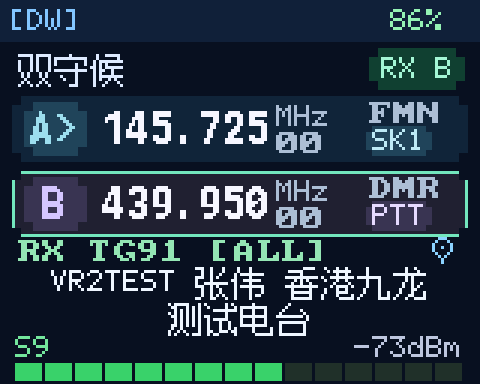 双守候 B 路接收 | 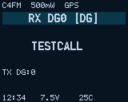 C4FM DN 来话 | 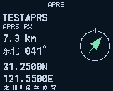 APRS 台站方位 |

> 第一次拿到电台，先按下方入门顺序完成开机、选信道和接收。如果电台还没刷入本固件，先看第 01 章。已经能正常开机的电台可以直接练习。

## 操作目录

### 第一次使用

- [入门 1　开机和认识按键](#start-01)
- [入门 2　第一次接收与调频](#start-02)
- [入门 3　第一次 FM 通联](#start-03)
- [入门 4　设置 DMR、C4FM 或 APRS 前先填这张表](#start-04)

### 功能与设置

- [01 安装与升级](#chapter-01)
- [02 主屏与按键](#chapter-02)
- [03 信道分区与联系人](#chapter-03)
- [04 VFO 与双守候发射](#chapter-04)
- [05 FM 收发与扫描](#chapter-05)
- [06 DMR 收发与组过滤](#chapter-06)
- [07 C4FM 日常收发](#chapter-07)
- [08 Wires X 与热点桥接](#chapter-08)
- [09 GPS 日期时间与数字位置](#chapter-09)
- [10 APRS 接收与日志](#chapter-10)
- [11 APRS 发信标与消息](#chapter-11)
- [12 日志录音与信号工具](#chapter-12)
- [13 中文输入与屏幕设置](#chapter-13)
- [14 高级设置与系统连接](#chapter-14)
- [15 故障排查与上机验收](#chapter-15)

## 界面图谱

按用途浏览 **52 类菜单入口、226 幅画面**。旧版图例中的版本号和部分文字用于识别界面，实际操作请以本手册正文为准。

- [日常收发（48 幅）](manual/atlas-operating.zh-CN.md)
- [菜单与联系人（11 幅）](manual/atlas-menus.zh-CN.md)
- [设置（30 幅）](manual/atlas-settings.zh-CN.md)
- [信息与定位（19 幅）](manual/atlas-position.zh-CN.md)
- [解码与日志（29 幅）](manual/atlas-logs.zh-CN.md)
- [电台配置（24 幅）](manual/atlas-radio.zh-CN.md)
- [帮助与信息（63 幅）](manual/atlas-help.zh-CN.md)
- [系统连接（2 幅）](manual/atlas-connection.zh-CN.md)

## 入门 1　开机和认识按键

第一次只练习看屏幕和进入菜单。装好电池和适配本机频段的天线。将电源／音量旋钮转过开机点，音量先设在较低位置。另一个顶部旋钮用来换信道、调频或改菜单数值。

| 找到哪里 | 本手册的叫法 | 初学时记住的动作 |
| --- | --- | --- |
| 侧面位于 PTT 上方的小键 | SK1 | 快捷菜单用它和绿键。双守候时，单独长按会从 A 路发射 |
| 侧面大键 | 实体 PTT | 通常按住发射、松开接收。双守候时固定发 B 路 |
| 侧面位于 PTT 下方的小键 | SK2 | 与绿键配合进信道详情，与 `*` 配合切模式 |
| 正面绿键和红键 | 确认和返回 | 主屏短按绿键进菜单，菜单里用绿键打开或确认，红键返回 |
| 正面的上下键 | 前面板上／下 | 菜单内选项目，DMR／C4FM 主屏可分别选 TG／DG |
| 顶部的另一只旋钮 | 信道／调谐旋钮 | 主屏换信道或调频。菜单步骤写「左右」时，用旋钮往两边转动 |

短按是按一下就松开，长按是按住等界面有反应。看到「SK2＋短按绿键」时，先按住 SK2，再按一下绿键，最后松开 SK2。双守时的 SK1 组合也一样，先按住 SK1，随即按绿键，避免 SK1 单独长按触发 A 路发射。

1. 开机到主屏后短按绿键。
2. 用前面板上下找到「电台信息」，按绿键打开。
3. 看电池电量与时间。按红键逐级返回主屏，到了主屏就停。普通 FM／DMR 主屏再短按红键，会切换信道页和 VFO 频率页。
4. 若键盘显示已锁，在锁定提示页按住 SK2 短按 `*` 解锁。若屏幕正常开机后始终很暗，用外光确认是否有文字，再去[故障排查](#chapter-15)核对背光设置和板型。

看到菜单能打开并返回，且没有出现 TX，就是这一步完成。按键位置可对照[上游 MD-UV380 操作说明](https://www.opengd77.com/archive/viewtopic6560.html?t=2380)。

[返回目录](#manual-toc)

## 入门 2　第一次接收与调频

**优先用写好的 FM 接收信道。** 请同伴或中继管理方给一个正在使用、可以守听的频率。以下练习只接收，无需 PTT。

1. 普通 FM／DMR 主屏若显示 A／B 和频率，先短按红键回到信道页。已进入 C4FM 时，先用 SK2＋短按 `*` 回到 FM，再切信道／VFO。
2. 绿键打开主菜单，向下找「分区」，再按绿键。用上下键选含该信道的分区，绿键确认。
3. 回到主屏后转动信道旋钮。用频道名称和信道参数核对频率，观察模式为 FM 或 FMN。用音量旋钮调到听得清楚。
4. 等频道里的正常来话，或请同伴在约定的频率发简短测试。信号条抬升、听到清楚人声，就是一次成功接收。若只有信号条，先比较双方模式、接收频率、宽窄带和接收亚音。

### 不写码表也能输入接收频率

1. 在 FM 信道主屏短按红键进 VFO。若显示双守候，可按住 SK1 后立即按住绿键，切到单守，先专注一个频点。
2. 在普通 VFO 单守页，按住 SK2 将调谐旋钮转向增加方向，选中 RX。先确认调谐的是接收频率。
3. 用数字键输入 8 位数，频率格式是小数点前 3 位、后 5 位。举例 **145.72500 MHz** 输入 `14572500`，电台自动放小数点；这是按键示例，实际填写约定的接收频率。第 8 位有效时自动应用，也可在频率输入页用绿键确认、红键取消。
4. 核对主屏显示，再等已知来话。看见两行频率时，RX 是本机听的，TX 是按发射键时会用的。调频联动可能同时调整 TX，本次练习仍只接收。
5. 若要回存储信道，先退出频率输入，再短按红键。需要恢复双守候时，在 FM／DMR VFO 用同一组 SK1＋长按绿键。

[返回目录](#manual-toc)

## 入门 3　第一次 FM 通联

用已写好并经同伴确认的 FM 信道练习。最容易核对的是两台电台的直频通联，双方在有权使用的频率上用同样的 RX／TX、带宽和亚音设定。用中继时先向维护者取得上下行、带宽及中继入口亚音，按下面的方向填写。

| 要填的手台字段 | 直频 | 通过中继 |
| --- | --- | --- |
| RX 接收频率 | 双方共同使用的频率 | 中继发给手台的频率，也叫下行 |
| TX 发射频率 | 与 RX 相同 | 手台送给中继的频率，也叫上行 |
| 收发亚音 | 按双方约定，无要求时关闭 | 发射亚音按中继要求。接收亚音只在确认下行带相同亚音时启用 |

1. 与同伴约好信道和测试时段。接好天线，使用适当的低功率。初学先用普通信道页或单守 VFO，确认屏幕没有「双守候」「仅接收」或 PTT 锁提示，并听一会儿确认空闲。
2. 按住侧面大 PTT 看到 TX 后，稍等片刻，再以正常音量说一句，例如「这里是〔自己的呼号〕，做个简短语音测试，请报告能否听清」。说完松手，并等待回话。
3. 松手后确认回到接收。请同伴报告是否听到整句及音质。自己看到 TX 只表示电台进入发射，听到对方确认才完成双向通联。
4. 如提示仅接收或超时，先松手，按[排查表](#chapter-15)核对信道与锁定状态。对方听不见时优先检查 TX 频率和亚音，能发但收不到回话时先查 RX 和静噪。每次只改一项，再做短测试。

掌握上述操作后，可按[第 06 章](#chapter-06)练习 DMR。进入 VFO 双守候后，**长按 SK1 发 A，实体 PTT 发 B**，按键不会跟着调频焦点改变。

[返回目录](#manual-toc)

## 入门 4　设置 DMR、C4FM 或 APRS 前先填这张表

码表是保存在电台里的配置文件。**信道**存收发频率、模式及附加条件，**分区**是能从主屏翻到的信道列表，**VFO**则用来临时调频。先请对方或热点管理者提供实际参数，把准备使用的一列填齐，再打开 CPS 或手台菜单。

| 需要向对方确认 | FM | DMR | C4FM | APRS |
| --- | --- | --- | --- | --- |
| 射频 | RX、TX、FM／FMN | RX、TX | RX、TX | 本地 FM RX／TX |
| 进入条件 | 有无 CTCSS／DCS 亚音 | 色码 CC、时隙 TS | DN 语音、DG-ID | 连到该信道的 1200 波特 APRS 配置 |
| 身份或送达目标 | 自己的呼号 | 自己的 DMR ID、对方要求的 TG 或单呼 ID | 自己的呼号。使用房间时另问五位房间号 | 自己的呼号与 SSID。发消息另问接收呼号与 SSID |
| 完成标志 | 同伴听清并回话 | 独立接收端收到正确组语音 | 同伴听清 DN。使用房间时另看核验回复 | 日志看到正确台站。发信标或消息由接收端确认 |

CC 是 DMR 色码，TS 是时隙，TG 是通话组。C4FM 的 DG-ID 用于 C4FM 的接收过滤和发射目标。五位房间号用来选 YSF 网络目的地。经 YSF2DMR 桥转发时，目标 DMR TG 由桥的设置决定。

**练习顺序**  先验证已知语音或数据能进本机，再试从本机发出。DMR 先测指定组，C4FM 先测 DN 直频或热点本地，APRS 先测接收日志。每条链路分别验证后，再开房间、桥接、GPS 发送或自动信标。

[返回目录](#manual-toc)

## 01 安装与升级

本手册适用于双段 TYT MD-UV380／MD-UV390。先按板型选包，再安装主固件和配套中文资源。普通单段 MD-380／MD-390 使用其他固件。

| 板型 | 下载包标识 | 背光／功放选择 |
| --- | --- | --- |
| 普通 5W＋GPS | 5W_GPS | PD8／PC6 |
| Plus 10W PD8 | PLUS_10W_PD8_GPS | PD8／PC6 |
| Plus 10W PC6 | PLUS_10W_PC6_GPS | PC6／PD8 |

### 判断是否需要刷机

- 已经使用本项目且字库、拼音正常，备份后只更新对应板型的 `03`。
- 已经运行其他 OpenGD77 分支、缺当前资源或仍使用 R250326 资源，先备份，再用同一板型的 `01 字库 → 02 拼音 → 03 主固件`。三个 ZIP 都要分别解压。
- 从原厂固件迁移时，用原厂 CPS 备份原厂码表和校准，并保存本机正常工作的原厂固件。按照上游迁移流程让兼容的 OpenGD77 主固件先正常开机，用 OpenGD77 CPS 的 **Extras → OpenGD77 Support → Backup Flash** 保存完整 Flash；在新码表或本项目字库写入前完成这份恢复备份。原厂码表另存，日常使用需准备 OpenGD77 格式码表。[上游迁移和备份步骤](https://www.opengd77.com/archive/viewtopic6560.html?t=2380)

### 每次用 CPS 刷入一份固件

1. 确认机身是双段 MD-UV380 或 MD-UV390，拿不准 10W 的 PD8／PC6 布局时先查本机板卡或过去已验证的安装记录。备份码表、校准、重要日志或录音；把备份与这台的型号标在一起。
2. 从发布页下载匹配板型，核对 `SHA256SUMS.txt` 后解压。保持电池电量充足。打开 **OpenGD77 CPS**，用写频线接电脑和关机状态的电台。
3. 同时按住侧面 **SK1＋PTT**，再转动电源旋钮开机。进入 DFU 升级模式时，屏幕可保持黑屏，顶灯通常红绿交替闪烁。若 CPS 找不到电台，先在 Windows 设备管理器核对 STM DFU 设备和驱动。
4. 在 CPS 选 **MD9600／MD-UV380** 对应的加载器，打开 **Extras（附加）→ Firmware Loader（固件加载程序）**。首次需要数字通联时，点 `Select official firmware (donor) file`，选择上游流程所要求、自己有权使用的 donor。部分 CPS 会在标题显示 `[+DMR]`。
5. 点 `Select Open firmware file & update`，选择本次要刷的 `.bin`，等 CPS 报告完成。刷 `01` 或 `02` 后关机，再松开按键正常开机，等屏幕显示 **COMPLETE - VERIFIED** 且背光熄灭，再关机进入下一步。每次烧录都要重新进入 DFU。看到 FAILED 就停在该步，检查板型、资源顺序和供电。
6. 刷完 `03` 后关机，再正常开机。看见日常主屏、背光和菜单可用后，先进「固件信息」核对版本，再按[入门 2](#start-02)测试 FM 接收。需检查中文字库和拼音时，可在备份需要保留的日志后按住 **SK1＋数字 5** 开机，`CJK data OK / log reset` 表示资源检查通过并重置旧日志索引。

DFU 用于烧录固件，正常开机显示主屏时才进行码表读写。donor 由加载器合入，日常选择刷入的是本项目的 `.bin`。[上游 CPS 固件加载说明](https://github.com/LibreDMR/OpenGD77_UserGuide/blob/master/OpenGD77_User_Guide.md#transferring-data-to-radio)

|   |   |
| --- | --- |
| 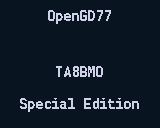 默认开机页 | 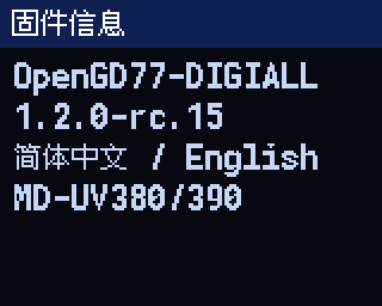 rc.15 版本信息示意 |

[返回目录](#manual-toc)

## 02 主屏与按键

先识别当前在信道模式还是 VFO，再按相应的按键。信道以码表存储名称和参数，VFO 用 A／B 两组频率即时操作。彩色主屏可显示当前目标、信号表、功率等状态，经典模式采用另一套布局。

|   |   |   |
| --- | --- | --- |
|  FM 彩色信道 | 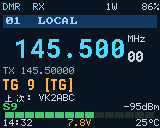 DMR 彩色信道 | 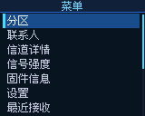 主菜单 |

| 按键 | 常用操作 |
| --- | --- |
| 绿键／红键 | 绿键打开菜单或确认。红键返回或取消。普通 FM／DMR 主屏短按红键切换信道与 VFO。C4FM 主屏红键保留当前模式 |
| 旋钮／前面板上下 | 旋钮通常换信道、调 VFO 或滚动列表。DMR 主屏前面板上下选 TG，C4FM 选 DG-ID。编辑页面按该页说明操作 |
| SK1＋短按绿键 | 打开信道或 VFO 快捷菜单。旧版图集所写的「橙键」在这两款双段机上对应此组合 |
| SK2＋短按绿键 | 打开信道详情。存储信道的持久保存按页面提示使用 SK2＋绿键，VFO 详情用绿键保存 |
| SK2＋短按 \* | FM → DMR → C4FM → FM |
| SK2＋前面板上下 | 数字模式调发射功率。显示档位取自设置和校准 |
| 按住 PTT | 单守时按当前信道发射。双守时由长按 SK1／实体 PTT 分别发射 A／B |
| SK1／SK2 单独长按 | 作用随模式变化。见双守、DMR 和 C4FM 章节 |

### 屏幕状态

RX 表示接收，TX 表示发射。FMN 为窄带 FM，DMR 和 C4FM 为数字模式。CC／TS 属于 DMR，DG-ID 属于 C4FM。呼号旁的图钉表示收到可用的位置数据。

打开「菜单 → 电台信息」或「信号强度」查看电池、时间及接收电平。S 表及 dBm 用于同场条件下比较接收，发射瓦数应由测量设备确认。

主菜单内短按 * 锁键盘，短按 # 切换 PTT 锁。锁定界面按 SK2＋* 解锁。

[返回目录](#manual-toc)

## 03 信道分区与联系人

1. 在 CPS 录入本机呼号和 DMR ID。为每个存储信道设 RX、TX、模式、功率和通话限时。中继有异频时分别核对收发方向。
2. DMR 信道配发送联系人、接收组列表、色码 CC 与时隙 TS。FM 信道配带宽及所需收发亚音。APRS 用 FM 信道关联适用的 1200 波特配置。
3. 将存储信道加入分区。手台主屏绿键进入「分区」，确认后用旋钮选择信道。
4. 临时编辑用 SK2＋绿键打开信道详情。更改后按当前页面指示保存到存储信道或 VFO。红键取消。用「仅接收」禁止该信道发射。

|   |   |   |
| --- | --- | --- |
| 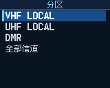 分区列表 | 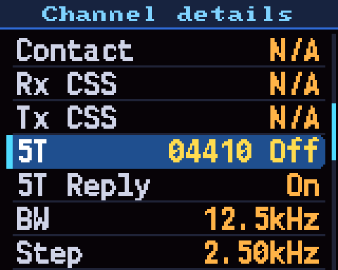 信道详情 | 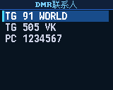 DMR 联系人 |

| 菜单 | 可做的事 |
| --- | --- |
| 联系人 | 浏览 DMR、DTMF 与五音联系人，建立、编辑或删除相应记录 |
| 快捷联系人 | 普通主屏 SK2＋# 调出快捷联系人。C4FM 中 # 和 SK2＋# 用于房间页 |
| 数字输入 | 普通 DMR 主屏短按 # 进入，选组呼、单呼等输入模式，输入后按绿键 |
| 信道／VFO 快捷菜单 | 在信道与 VFO 间复制，选择 FM／DMR 过滤、脱网直通和 VFO 收发频率操作。VFO 可新建存储信道 |
| 电台配置 | 新建信道和分区，管理分区成员、名称、配置密码、五音联系人及 APRS 配置 |

### 从空白码表建立一个接收信道

1. 以正常模式开机，连接写频线，打开 OpenGD77 CPS。使用「从电台读取」后另存一份当前码表。有备份时先另存副本再编辑，便于恢复。
2. 在 CPS 的 **Channels（信道）** 添加一条，起名「FM 练习」。模式选 FM，填已核对的 RX 与 TX，接收亚音按对方参数填。只做守听时勾选 **RX Only（仅接收）**。
3. 在 **Zones（分区）** 新建分区或打开已有分区，把「FM 练习」加入成员。保存文件后，使用「写入电台」发送到手台。等提示写入结束再拔线或重启。
4. 在手台短按绿键进「分区」，选择刚写的分区并确认。转顶部信道旋钮，应看到「FM 练习」。如果名字在 CPS 能看见但手台选不到，先核对是否加入当前分区及码表是否成功写入。
5. 要增加 DMR 信道时，先建组呼联系人，填目标 TG 数字，再将需要守听的联系人加入接收组列表。到 DMR 信道设置相同的 CC／TS，并关联发射联系人和接收组列表。最后把新信道加入分区、保存并写入。

### 功率和校准

50／250／500／750 mW 和 1／2／3 W 为共用低中档。5W 构建还提供 4／5 W，10W 构建提供 5／10 W。＋W 为用户自定义档。按板型使用本机校准资料，勿导入其他电台的校准值。

[返回目录](#manual-toc)

## 04 VFO 与双守候发射

进入 FM／DMR VFO 后，默认在 A／B 间轮流收听。蓝色为 A、紫色为 B。青绿标示接收，琥珀标示输入，暖红标示发射。大于号标示调频主路，SK1／PTT 标示发射键。频率末两位印在 MHz 下方。

|   |   |   |
| --- | --- | --- |
| 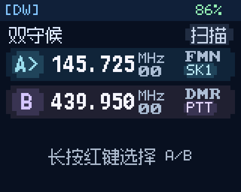 双守巡听 |  B 路收到 DMR | 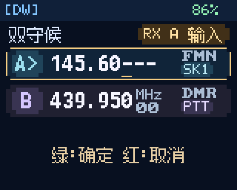 A 路录入 RX 频率 |

| 操作 | 结果 |
| --- | --- |
| 长按红键 | 选择 A 或 B 作为调频主路 |
| 旋钮或数字键 | 暂停轮询并编辑主路。输入中的草稿及另一频率同时可见。结束后约 2.5 秒恢复轮询 |
| 单独长按 SK1 | 按住发射 A 路，达到已设长按阈值后开始。松开停发 |
| 按住实体 PTT | 发射 B 路。松开停发 |
| SK1＋长按绿键 | 在双守与单守之间切换。先按住 SK1，再在长按发射触发前按下绿键 |
| SK1＋短按绿键 | 打开快捷菜单，从「双守候」也能切换 |

|   |   |
| --- | --- |
| 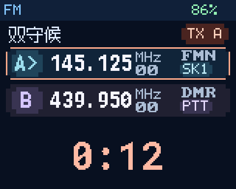 A 路异频发射与计时 | 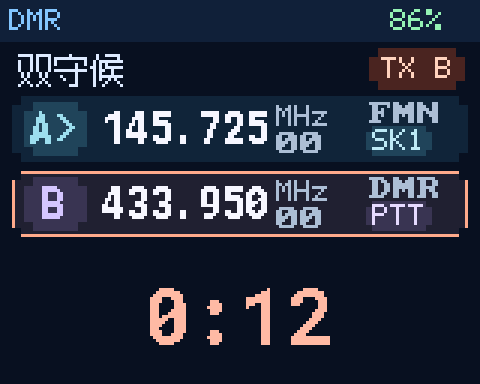 B 路异频发射与计时 |

### 练习 A／B 双守候

1. 在普通 FM／DMR 单守 VFO 上长按红键选 A，再按[入门 2](#start-02)的方式输入 RX。长按红键改选 B，输入另一个接收频率。按住 SK1 再长按绿键开启双守候。看到 A／B 两行和巡听标签后等来话，青绿 RX 标牌指出收到信号的那一路。
2. 长按红键切换 A／B 后，先看哪个字母旁有 `>`，再调频。输入时另一行仍会保留。输入完成后停手约 2.5 秒观察是否恢复巡听。
3. 要测试发射，先分别核对 A、B 的 TX 频率和功率，并让同伴守听正确的上行。A 路按 SK1 到亮起 TX A，B 路按实体 PTT 到亮起 TX B。每次松开两键再换路，确认返回接收。

一次发射由触发键控制。两键都松开再发另一路。双守时暂停 VOX 和 PTT 锁存。锁键、仅接收、频段限制、发射超时和频率输入状态仍会限制发射。结束后返回原调频主路。C4FM 或当前主路进入受保护的 APRS 接收时使用单路操作。

[返回目录](#manual-toc)

## 05 FM 收发与扫描

### FM 收发和亚音

选择 FM 或 FMN，并核对收发频率、带宽及中继亚音。FM 或 DMR 的普通 VFO 单守状态下，可用 SK2＋旋钮切换输入焦点，再调 RX 或 TX。频率联动打开时，调整 RX 会带动 TX 并保持频差，编辑前可在 VFO 快捷菜单核对联动选择。

CTCSS 是连续亚音，DCS 是数字亚音码。信道详情通常有独立的接收和发射亚音选项。要排查「信号条动但无声」，先记下原接收亚音，按信道用途暂时关闭接收亚音做对照；听见后再恢复或改成发射台实际发出的亚音。进入中继所需的是本机 TX 亚音，填写前向中继管理者核对。

FM 直接按 PTT 通话。发射期间按 SK2 可发 1750 Hz 音。接收时超长按 SK2 可进入临时监听，松开退出。音量用旋钮调整，静噪用主屏相应控制或信道详情调整。

### 范围扫描和瀑布图

1. 在普通 VFO 用前面板上键长按进入范围设置。输入低频与高频，确认后再次长按上键开始。扫描时前面板下键可反向，暂停时可按 * 略过干扰频点。按红键停扫。
2. 在 FM VFO 长按 # 打开瀑布图。普通旋钮调整中心，SK2＋旋钮改变跨度。短按 * 启用或关闭遇信号停留，停留时再按 * 跳过该频率。长按 * 在 FAST 和 FINE 间切换。
3. FAST 每行测 80 个频点，调谐后每点等待 15 ms，纯驻留预算约 1.2 秒。FINE 和遇信号停留测 160 点，每点 25 ms，纯驻留约 4 秒。实际成行时间还包括调谐、绘图和其他任务。

|   |   |   |
| --- | --- | --- |
| 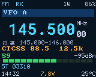 VFO 范围扫描 | 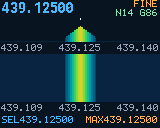 实时瀑布图 | 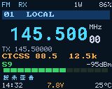 亚音搜索 |

### 信道扫描和亚音扫描

信道模式沿用码表扫描选项与扫描跳过标志。进入设置 → 电台设置可核对扫描停顿策略和等待时间。亚音扫描从 VFO 快捷菜单选择 CTCSS 或 DCS 搜索，适用于模拟信号。瀑布图按频率顺序取 RSSI，射频接收机同时只停在一个频点。

[返回目录](#manual-toc)

## 06 DMR 收发与组过滤

1. 用有效 DMR ID、收发频率、CC 和 TS 建立信道，并填入发送联系人和接收组列表。直通与中继按实际用途选模式。
2. 主屏用前面板上下键选组。来话期间切组会重新应用接收过滤，避免继续播放旧组音频。
3. 在普通 DMR 单守主屏长按 SK1 切 ALL／指定 TG。短按 SK1 或长按 0 打开 DMR 搜索，绿键锁定搜索结果中的 TG／CC／TS，红键恢复进入前配置。双守中长按 SK1 改为 A 路发射，组过滤从快捷菜单调整。

| 状态 | 含义 |
| --- | --- |
| TG | 采用当前选定目的组过滤 |
| TGL | 使用码表接收组列表过滤 |
| ALL | 放行全部目的组。CC／TS 仍按各自开关过滤 |
| RX TG91 [ALL] | 当前实际来话为 TG91。屏幕下方 TX TG:9 表示本机发射目标为 TG9 |

|   |   |   |
| --- | --- | --- |
| 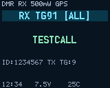 ALL 下实际来话组 | 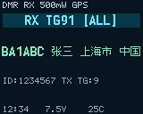 中英文姓名与城市 | 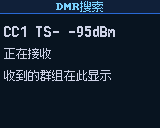 DMR 搜索 |

### 做一次指定组收发

1. 用已设置的 DMR 信道先收听。请热点或同伴在指定 CC、TS、TG 上发一条语音，观察来话显示的呼号与 `RX TG` 数字。数字相符且可懂语音，表示接收链路工作。
2. 主屏用前面板上下选定用于回话的组，看 `TX TG` 是否正确。若只要听该组，选 `TG` 过滤。可让同伴再发另一个组，确认指定过滤时对方语音不会被播放。
3. 待空闲后用实体 PTT 发短句。松手后用独立 DMR 电台或热点日志和对端回话确认目标组。只看到面板亮 TX 时，再查色码、时隙、所选 TG，以及异频方向和 CPS 数字声码器合入。

### 时隙与来话身份

普通 DMR VFO 短按 * 切换时隙。单守 VFO 收到可识别的来话时，短按 SK2 可采用来话目标，以及能够取得的时隙和色码。回话前比较 RX 和 TX 栏，确认发射目标。长按绿键可打开带位置图钉的来话详情。

[返回目录](#manual-toc)

## 07 C4FM 日常收发

普通 5W 和两种 10W 构建均开放 C4FM DN 收发与 GPS 功能。两种 10W 的 C4FM 空口表现仍需真机确认。切到 C4FM 后，接收默认使用 RAM 路径。可直接从主屏按住实体 PTT 发 DN 语音。

|   |   |   |
| --- | --- | --- |
|  C4FM 主屏来话 | 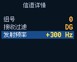 发射频率微调 | 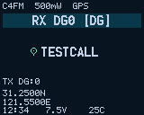 来话位置图钉 |

| 按键 | 功能 |
| --- | --- |
| 前面板上下 | 选 DG-ID 0～127 |
| 短按 \* | 输入 DG-ID，绿键确认，红键取消，\* 退格 |
| 短按 SK1 或长按 SK2 | 临时搜索全部 DG，再按退出。既有发射 DG 保持原选择 |
| 长按 SK1 | 切换并保存 ALL／指定 DG 过滤 |
| SK2＋绿键或长按 \* | 信道详情中设置 DG、接收过滤、发送 GPS 与 TX 微调 |
| 短按 # 或 SK2＋# | 打开 Wires-X 房间页 |
| 实体 PTT／长按绿键 | 按住发送 DN。有效位置来话可长按绿键看距离和方位 |

### 从第一次听到 DN 到回话

1. 在主屏用 SK2＋短按 `*`，每次看模式标签，直到显示 `C4FM`。核对自己的呼号与实际收发频率。
2. 先用双方约定的 DG-ID。主屏上下选择，或短按 `*` 直接输数字，绿键确认。听不见时可以短按 SK1 临时放行全部 DG；测试后再按退出，避免忘了当前接收模式。
3. 请对方发送 DN。屏幕有正确呼号，同时能听懂语音，接收即通过。随后从主屏按住实体 PTT 发短句、松手，等对端回话。使用热点时，测试前先等热点空闲。
4. 只有信号、没有呼号时，先核对 DN、频率和 DG 过滤。能看到呼号但听不懂时，保持一套已知能工作的条件，只改一个变量做对照，先从基础语音验证开始。

### 频率与时限

热点接收 433.950 MHz、发送 439.950 MHz 时，手台 RX 填 439.950 MHz，TX 填 433.950 MHz。C4FM TX 微调默认 0 Hz，可用 50 Hz 步进在 ±1500 Hz 内调整。热点的 RXOffset 影响多模式，先确认 DMR 的可用设置，再做独立 C4FM 对照。

主屏发射采用信道 TOT，设为 0 时回退 60 秒。仅接收、频段限制、PTT 锁和声码器条件仍适用。普通发布构建隐藏高级 RF 测试和诊断入口。显式开发构建中的 4:MIC、调制探测和捕获功能属于单独测试范围。

[返回目录](#manual-toc)

## 08 Wires X 与热点桥接

1. 在 C4FM 主屏短按 # 打开房间页。进入页面只显示设置，按 # 才发查询。
2. 输入五位房间号并按绿键连接，长按 * 断开。只有核验回复才显示连接结果。出现 No Reply 时，结合热点日志判断查询上行、网关回复和手台下行各环节。
3. 打开 Pi-Star 普通配置页，启用 YSF 和 YSF2DMR 并应用后，在 System Fusion 区配置本人有效 DMR ID、目标主站、Hotspot Security 和目标 DMR TG。测试本机桥时，启动主机选择 00002／Link YSF2DMR。
4. 让热点暂时空闲，按 PTT 发短句。用独立 DMR 接收端或 Hoseline 核对目标 TG 的实际来话。MMDVMHost 的 RF header、end of transmission 和 YSFGateway 的 Received DX、DX Reply 分别对应不同环节。

|   |   |   |
| --- | --- | --- |
| 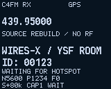 发完查询等待回包 | 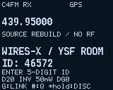 房间页与测试字段 | 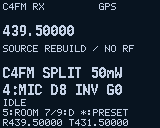 异频对照示例 |

| 名称 | 配置位置 |
| --- | --- |
| DG-ID | 手台 C4FM 目标值。热点默认通常为 0，以自己的配置为准 |
| YSF 房间号 | 五位 Wires-X／网关反射器编号，在房间页输入 |
| DMR TG | 在 YSF2DMR 桥和 DMR 端设置。测试本机桥时保持启动在本机桥 |
| BER 和 RXOffset | BER 需要同条件对比。初测先记录供电、档位、距离、热点空闲状态、原偏移及每次日志 |

查房间时按顺序观察两处。手台先出现 `WAIT`，收到核验回包后才会显示 `CONNECTED`；热点日志要看同一次操作是否有 `Received DX` 和 `DX Reply`。若都没有，先回头检查手台到热点的上行；若热点有回复而手台超时，再查下行频率和手台接收。房间显示连上后还要单独做语音测试。

调制档位 D22／INV／G4／N2／E1 是已用于普通 5W 单机对照的参数。不同板子和热点可以需要不同参数。热点本地转发尾音或回声只能说明部分链路工作，独立接收端能收到语音才确认语音抵达目标组。

[返回目录](#manual-toc)

## 09 GPS 日期时间与数字位置

### GPS 和时间

进入「菜单 → GPS」查看卫星、坐标及定位状态。新装或恢复设置时 GPS 默认开启，自动背光 30 秒。手动关闭 GPS 或改变已保存设置后按菜单保存。定位依赖实际 GPS 硬件和有效卫星数据。当前发行配置关闭 GPS Flash 轨迹记录。

在「菜单 → 电台信息」用上下键找到日期或时间，分别输入 YYYYMMDD 或 HHMMSS，按绿键保存。手动校时后自动 GPS 校时切到关闭，需要时在「设置 → 通用设置 → GPS 校时」重新开启。

「设置 → 显示设置 → 时区」修改偏移后会选用本地时间。例如北京时间用 +8:00。选择「时间 → UTC」可查看 UTC。主屏、电台信息与日志使用同一显示时区，GPS 校时给 RTC 提供 UTC。

|   |   |   |
| --- | --- | --- |
| 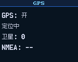 已开启并等待定位 | 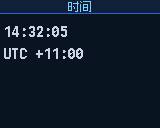 电台信息中的时间 | 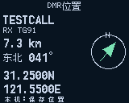 数字位置指南针 |

### 接收与发送数字位置

带图钉的 DMR／C4FM 来话可长按绿键打开位置页，显示经纬度、距离和初始方位。最近收听选中带图钉的对象后，长按绿键看 LAST 历史位置，短按绿键仍选组。没有本机参考坐标时仍可查看对方经纬度。箭头以北向上，不随手台转向变化。

发送 DMR GPS 时，进入信道详情，将所用时隙的「TA 发送」设为 GPS 或两者。C4FM 在信道详情独立打开「发送 GPS」，默认关闭。每次发射取一份有效实时定位，最新有效 RMC 要在 10 秒内。无定位或过期时继续发语音并省略坐标。

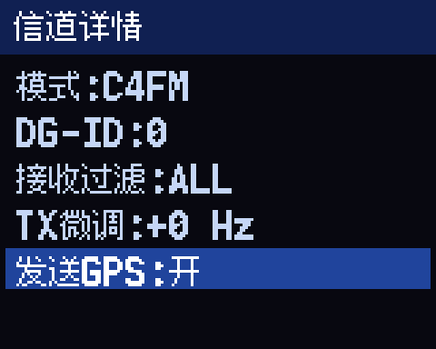 C4FM 发送 GPS 设置示意

[返回目录](#manual-toc)

## 10 APRS 接收与日志

1. 在 CPS 建立当地 APRS 的 FM 信道，关联有效的 1200 波特 APRS 配置。切到该信道，或将 FM VFO 调到相同的实际 RX 频率。后台确认匹配后自动解码。
2. 在其他模式时可进入「日志 → APRS」，长按 # 开启优先守候。先取当前有效关联，再找 CPS 中第一个有效配置。列表底部显示实际监听频率。再次长按 #、退出日志或按 PTT 可撤销守候并恢复原收发环境。
3. 有效位置包在允许弹出的空闲状态自动打开位置卡片，约 5 秒回到原频道或页面。通过日志绿键手动打开时可停留查看，左右切换位置与备注，红键返回。
4. APRS 日志最近保存 16 条。满时替换最旧的未收藏记录。按住 SK2 短按 # 收藏或取消收藏，呼号前出现星号。单独短按 # 清除未收藏记录。

|   |   |   |
| --- | --- | --- |
| 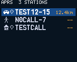 APRS 台站列表 |  经纬度与目标方位 | 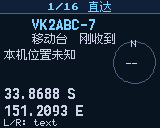 缺本机位置时的显示 |

### 接收排查

调到对应的 FM 实际频率，核对配置和 1200 波特、静噪与接收亚音。APRS 优先守候使用单接收链路暂时占用原频道接收。因此扫频、双守、发射以及某些提示或播放期间可能接不到报文。

第一次可请同伴发一条包含有效坐标的报文。先确认「日志 → APRS」出现对方呼号，再按绿键看经纬度。列表有记录但没自动弹出时，回主屏且退出编辑，再等下一条有效位置包；已收到的记录可手动打开。坐标有显示而距离空白时，去 GPS 页等本机定位，再看同一条记录。

后台 GPS 关闭仍能接收别台报文，本机 GPS 只影响自动位置发送和距离参考。文本含类似坐标的内容不会触发位置页。被锁屏、编辑或播放挡住的自动弹窗会在短时间后过期。

[返回目录](#manual-toc)

## 11 APRS 发信标与消息

### 配置台址和精度

「设置 → APRS → 位置」选 GPS 发送实时定位，或选信道使用 CPS 固定坐标及可用的电台保存位置。发送前检查报文里会公开的呼号、台址、路径和备注。

「菜单 → 电台配置 → APRS 设置」打开信道关联的配置，调整「模糊度」并保存。新配置默认 0（完整），CPS 导入既有配置保留原值。其余档位按十进制度设定。

| 档位 | 对应报文 |
| --- | --- |
| 0（完整） | 普通报文用 !DAO! 补足精度，支持扩展的接收端可还原四位十进制度小数。压缩模式用 Base-91 |
| 较小步长 | 0.0002°、0.001°、0.002°、0.01° |
| 较大步长 | 0.02°、0.1°、0.2°、1° |

要练习发送时，先在对应 FM 信道用手动方式发一条。检查接收站或网关日志里是否出现自己的呼号与坐标，确认正确后再启用定时报送。位置精度与本机能否定位是两项不同的设置。

### 信标和文字

1. 手动信标在已关联有效配置的 FM 信道上操作。将模式设为手动，获得有效坐标，在主屏用 SK1＋2 发信标。自动模式按 APRS 设置中的发送策略和间隔运行。
2. 在日志的 APRS 入口按 * 打开消息，也可走「APRS 发送」入口。填接收呼号及内容，按绿键发送。按页面键位选择是否带位置。仅接收或临时 APRS 优先守候时无法用该临时配置发射。
3. 文字页的 WhatsApp／邮件入口依赖 APRS 网关的注册、可用性与转发配置。填写最少的必要资料。以接收端确认交付，电台发包与外部服务送达属于不同环节。

|   |   |   |
| --- | --- | --- |
| 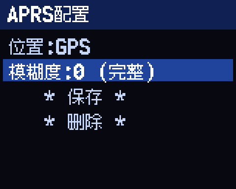 APRS 模糊度设置示意 | 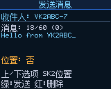 APRS 消息编辑 | 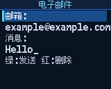 电子邮件网关编辑页 |

[返回目录](#manual-toc)

## 12 日志录音与信号工具

「菜单 → 日志」汇总 APRS、呼叫记录、录音与摩尔斯相关入口。列表中的来话呼号与日志时间来自对应接收事件。

|   |   |   |
| --- | --- | --- |
| 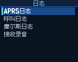 日志中心 | 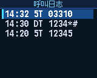 呼叫记录 | 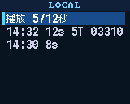 FM 录音播放 |

| 功能 | 操作与范围 |
| --- | --- |
| FM 接收录音 | 在录音列表开启自动录音。选录音并按绿键播放或停止，按页面提示删除。空间按循环方式管理。DROP 或 I/O 提示代表可能丢帧或写入失败 |
| 通话记录与最近收听 | 在日志打开呼叫记录可看详情。主菜单的最近收听用于选择 DMR 联系对象和查看收到的位置 |
| 五音选择呼叫 | FM 主屏长按 0 打开。可输入或选已保存联系人，按页面发送。接收与应答规则在相应设置中调整 |
| DTMF | 从联系人选择或在 FM 发射中使用数字键生成 DTMF。收到的呼叫可进入呼叫日志 |
| 摩尔斯发送与练习 | FM 主屏短按 \* 进入摩尔斯发送。练习、已接收内容和训练参数从相应页面打开 |
| 猎狐辅助 | 模拟主屏长按 \* 进入，按频率、信号和衰减提示做测向 |

|   |   |   |
| --- | --- | --- |
| 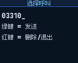 五音选择呼叫 | 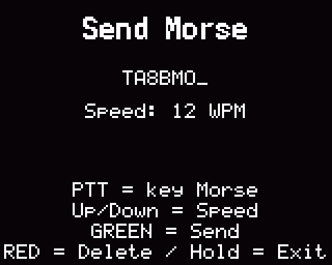 摩尔斯发送 | 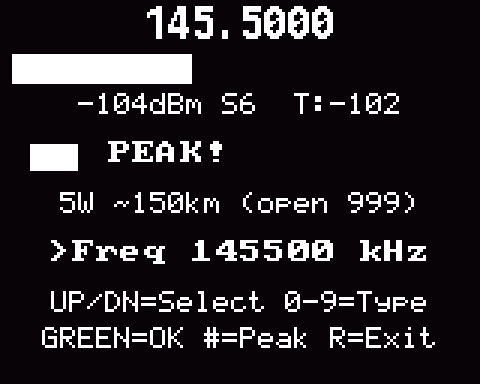 猎狐辅助 |

关机前结束播放或录音，正常关机给待写记录留出时间。接收录音只覆盖 FM。遗失的开头、结束或掉块应结合播放、录音状态、一定时长的通话和正常关机做分组复测。

[返回目录](#manual-toc)

## 13 中文输入与屏幕设置

### 拼音输入

1. 打开信道、DMR 联系人、分区或五音联系人的名称编辑页，按 SK2＋# 进入拼音，底部显示 PY 和候选。
2. 用数字键多击输入字母。2=abc，3=def，4=ghi，5=jkl，6=mno，7=pqrs，8=tuv，9=wxyz。拼音不带声调，ü 用 v。
3. 左右选候选，上下翻页。在这类菜单里旋钮可对应左右。绿键插入汉字，红键退一位拼音，拼音空时退出。再次按 SK2＋# 返回原编辑器，再按存储页面提示保存。
4. 例如输入 zhong 选「中」，输入 guo 选「国」。码表名称上限是 16 字节，纯汉字最多 8 个。呼号与 APRS 协议字段沿用规定字符。

|   |   |   |
| --- | --- | --- |
| 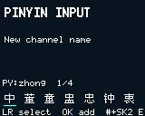 拼音与选字 | 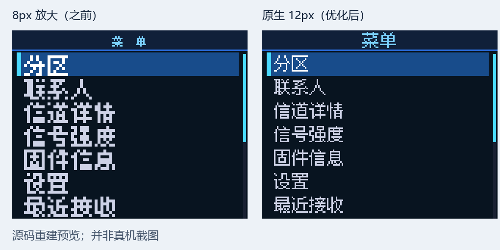 中文点阵比较 |  语言选项 |

### 语言显示和音量

设置 → 语言可选择简体中文或英文。显示设置可切经典／彩色布局、背光、对比与反色，日夜主题可分别编辑。开始调色时保留一套可读的主题。音量旋钮控制播放，声音设置可调整语音提示、按键音、接收提示和麦克风相关选项。

普通状态栏、小字提示、菜单正文和主屏大字使用不同字号。DMR 大字来话页会保留呼号、姓名、城市的换行和分页，双守页使用至多两行的姓名排版。若拼音页提示 FONT/PINYIN MISSING，核对两份资源写入顺序与板型。

[返回目录](#manual-toc)

## 14 高级设置与系统连接

| 入口 | 用途与注意事项 |
| --- | --- |
| 通用设置 | GPS、GPS 校时、省电、锁键与自动关机等行为 |
| 电台设置 | 发射限频、功率、扫描、过滤、超时等。没有空口依据时保留已验证的值 |
| 显示与主题 | 背光时间和亮度、时区、经典／彩色、日间／夜间配色 |
| 声音设置 | 音量显示、提示等级、语音资源、接收提示、麦克风与音频相关选项 |
| 校准 | 查看或调整本机校准。先留原始备份，使用对应板卡和测量设备 |
| 卫星 | 查看载入的卫星数据、可见过境与跟踪，核对时钟、位置及资料时效 |
| USB 热点 | 连接兼容主机并配置热点模式。屏幕显示状态与正在经由 USB 处理的通信 |
| CPS 写频 | 电脑连接后读写码表、维护本机备份或更新固件。写入期间保持连接 |
| 固件信息和使用手册 | 核对本机版本、硬件范围，并浏览机内帮助主题 |

|   |   |   |
| --- | --- | --- |
| 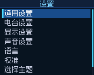 设置菜单 | 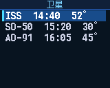 卫星页面 |  USB 热点 |

### 快捷操作与存储边界

支持快捷键的主菜单选项可用 SK2＋数字登记，之后在主屏按相同组合打开。主屏 SK2＋长按对应数字可清除。外部 Flash 最后 512 KiB 给中文字库与拼音资源。录音和轨迹选项也受空间布局约束，更换资源或回退旧版本前备份。

图谱包含页面内选项、确认框和典型状态。参数和入口随当前收发模式、码表、语言、板型或开发构建切换。颜色与示例频率以手台实际显示为准。

[返回目录](#manual-toc)

## 15 故障排查与上机验收

| 表现 | 先核对 |
| --- | --- |
| 有声音且屏幕发黑 | 借助外光查看是否有文字，核对 5W／10W 和 10W PD8／PC6 板型、背光设置、正确的 03 包。保留本机校准 |
| PTT 显示仅接收，或不发射 | 当前页面、板型、发射锁、发射频率、仅接收、频段限制、TOT、声码器条件。双守时先核对发射按键对应哪一路 |
| DMR 串组或组号看起来不对 | 看 RX TG 和 TX TG 两栏，核对 TG／TGL／ALL、CC／TS。用两个组轮流来话确认实际放音 |
| C4FM 热点无记录或房间超时 | 核对手台异频、热点是否正在发射、DG、实际 RF 日志和网关返回。不要把单次收到呼号当成持续通联通过 |
| APRS 位置偏移或未弹窗 | 比对同一时刻 GPS 和原始报文、CPS 模糊度、接收端 !DAO! 解析及底图坐标系。锁屏和编辑时弹窗可能延后 |
| 时间显示仍为 UTC | 显示设置核对偏移与「本地」，电台信息核对日期。手动校时后按需要重新打开 GPS 校时 |
| 日志或录音缺项 | 确认正常关机、录音开关、DROP／I/O 状态和空间。核对 APRS 收藏或清除操作 |

### 反馈问题前记下这五项

记录机背型号和板型、固件版本或 ZIP 名、使用的模式与频率、按键和菜单路径、最后看到或听到的结果。以「DMR 指定 TG 时另一组仍出声」为例，提供本机 `TX TG`、屏幕上一行的 `RX TG` 和当前 `TG／TGL／ALL`，并写清换组的按键。热点类问题同时记下发生时间，只贴同一次测试的相关日志。

### 双守专用复测

为 A、B 预设不同的合法 RX／TX，保持低功率并用独立接收端确认。测试 SK1 发 A、PTT 发 B，分别记录实际频率、模式和松键恢复。两键交叠应保持先触发的一路，松开后不接续发射。重新验证 SK1＋绿键、独立 SK2 临时监听，以及某一路设为仅接收时的限制。

### 反馈与恢复

记录具体板型、完整包名、显示版本、模式、复现步骤和日志时间。提交前移除密码、私人位置和非必要录音。回退使用本机已验证的对应板型固件与配套中文资源。项目免费、非商业，保留原作者及第三方组件许可。发布入口和致谢见下方链接。

[返回目录](#manual-toc)

[非商业发布与许可](https://github.com/xunyu5800-alt/OpenGD77-DIGIALL-Testing/blob/main/DISTRIBUTION.md) · [作者与呼号致谢](https://github.com/xunyu5800-alt/OpenGD77-DIGIALL-Testing/blob/main/ACKNOWLEDGEMENTS.md)
