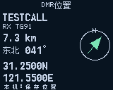
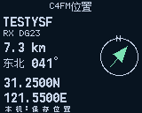
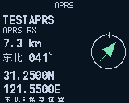
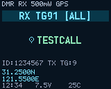
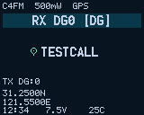
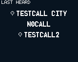
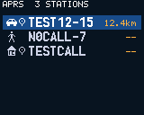
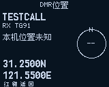

# APRS / DMR / C4FM position pins, distance and compass (v1.2.0-rc.6)

[中文](RECEIVED_POSITION.zh-CN.md) · [Download](https://github.com/xunyu5800-alt/OpenGD77-DIGIALL-Testing/releases/tag/v1.2.0-rc.6)

All three modes share the position body: remote latitude/longitude, distance, initial bearing and a north-up compass. The arrow points toward the target. This is a target bearing, not handset heading or a magnetic compass.

| DMR | C4FM |
| --- | --- |
|  |  |

Images reconstruct production pages/fonts with example identities and coordinates; they are not radio photographs. The APRS example uses the production shared body with an illustrative header.

## Controls

- **A pin beside a caller means valid remote coordinates have been received**. The same icon appears on DMR/C4FM callers, DMR Last Heard (name/details) and APRS station rows. It remains visible without local GPS; missing/invalid remote coordinates have no pin. It does not indicate a local fix or guarantee freshness.
- **In Last Heard, select a pinned caller and hold GREEN** for its last received position/compass, labelled `LAST TG…` or `LAST PC…`. Another call cannot overwrite the snapshot. RED returns to the selected item; short GREEN retains group selection. In the details row, the pin sits between TG and TS.

- **Hold GREEN on the DMR/C4FM main screen** to view position; RED returns. Short GREEN keeps the normal menu and SK2+GREEN keeps channel details. Numeric QuickKeys are unchanged.
- Digital calls retain the caller screen; **no automatic position popup**. Open after call identity and position arrive. Missing remote position is stated explicitly; local coordinates are never substituted for it.
- New reports from the same identity can update the open page. Another caller, target or protocol cannot replace its selected station. After the call, an already-open page retains its last received point. Local position refreshes periodically; busy C4FM RX can defer redraw. Reopening reads the current call; an absent live identity is not matched to an old name.
- **APRS still automatically opens its position/compass card on valid position packets**. Alternatively open the APRS log/list, select a station and press GREEN; LEFT/RIGHT switches compass/coordinates and text, RED returns to the list.
- The page is read-only. Return to the C4FM main screen before PTT. Existing room/diagnostic, frequency/channel-number entry, scanning and active-TX gestures are retained.

| DMR caller pin | C4FM caller pin |
| --- | --- |
|  |  |

| Last Heard pins | APRS pins and station symbols |
| --- | --- |
|  |  |

APRS retains station symbols, with the pin between symbol and callsign and distance at the right. Without local coordinates, a pinned station shows `--` distance. Full bearing arrows remain on the compass card. Digital callers reserve room for the pin while retaining whole-character name/city paging.

## Reference position

A valid enabled live GPS fix takes priority, otherwise a valid saved location is used. The footer identifies that local reference as live GPS or saved position. Distance uses a spherical great circle; the initial bearing is clockwise from north toward the remote station.

Without a valid local reference, the complete remote coordinates remain visible with “No local position”; distance and direction are unavailable. Invalid coordinates despite a GPS-fix flag fall back to saved location with the correct label. Zero coordinates are valid. Coincident and exactly antipodal points have no unique direction, so distance remains while the arrow is suppressed.

DMR position must match the accepted live source/destination and filter. C4FM uses decoded position fragments; a DG change clears the previous point and pending fragments. The remote station must actually transmit supported location data.

Tests cover known distance/cardinal directions, the date line, zero/coincident/antipodal points, live/saved fallback, DMR identity/filter guards, C4FM DG, manual key/menu/lock return, same-station updates, caller-change isolation and text bounds. Radio UI/audio acceptance remains pending. Existing project font/pinyin installations only need the matching new03 main firmware.
