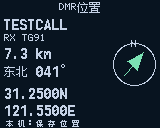
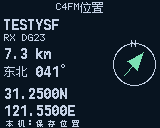
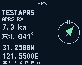
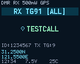
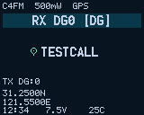
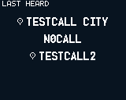
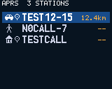
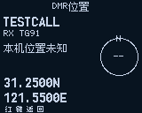

# APRS／DMR／C4FM 位置提示、距离与指南针（v1.2.0-rc.5）

[English](RECEIVED_POSITION.en.md) · [下载](https://github.com/xunyu5800-alt/OpenGD77-DIGIALL-Testing/releases/tag/v1.2.0-rc.5)

三个模式共用位置正文：对方纬度、经度、距离、初始方位角和北向指南针。箭头指向目标，图上方始终为北；这是目标方位，不是机身航向或磁罗盘。

| DMR | C4FM |
| --- | --- |
|  |  |

图片由生产页面／字体重建，使用示例呼号和坐标，非真机截图。APRS 示例使用同一生产位置正文，标题与呼号是示例。

## 操作

- **呼号旁的图钉表示已收到该对象的有效位置**：DMR／C4FM 来话主屏、DMR 最近收听（普通及详情）、APRS 站点列表共用同一图标。没有本机 GPS 定位仍显示图钉；未收到或坐标无效则不显示。图钉不是本机 GPS 标志，也不保证位置实时有效。
- **最近收听：选中有图钉的呼号后长按绿键**，打开其最后收到的位置／指南针，`LAST TG…` 或 `LAST PC…` 标明历史记录。另一来话不覆盖此快照；红键回到所选条目，短按绿键仍沿用选组操作。详情行的图钉在 TG 与 TS 之间。

- **DMR／C4FM：主屏长按绿键**查看位置，红键返回。短按绿键仍打开原菜单，SK2＋绿键仍进入信道详情；不占用数字 QuickKey。
- 数字来话保留呼号主屏，**不会自动弹出位置页**。应在来话身份和位置数据已收到时打开；未收到位置时明确提示，不把本机坐标当作对方坐标。
- 同一来话对象的新位置可以刷新页面；另一呼号、组号或协议的来话不会把已打开的对象替换掉。来话结束后，已打开的页面保留最后收到的位置。本机定位定时更新，C4FM 接收忙时延后重绘。退出再打开，重新读取当前来话；没有当前有效来话时不会凭历史姓名关联坐标。
- **APRS：收到有效位置包后仍自动打开位置／指南针卡片**。也可从日志进入 APRS 列表，绿键打开站点；左右切换坐标指南针与文本详情，红键返回列表。
- 位置页只查看数据。C4FM 要发射时先用红键返回主屏，按原 PTT 操作。房间页、诊断页、频率／信道编号输入、扫描和发射期间的原操作保留。

| DMR 来话图钉 | C4FM 来话图钉 |
| --- | --- |
|  |  |

| 最近收听图钉 | APRS 图钉与站点符号 |
| --- | --- |
|  |  |

APRS 列表保留原站点符号，图钉位于符号与呼号之间；距离位于右侧。缺少本机位置时显示图钉和 `--`，完整方向箭头在位置卡片。数字来话为图钉预留宽度，超长中文／城市仍按页显示，不丢整字。

## 本机位置与计算

优先使用已开启 GPS 且有效的实时定位；否则使用有效的保存位置。页底分别标为“本机:实时GPS”或“本机:保存位置”，这里描述的是本机参考点。距离按球面大圆计算，方位角为从本机到对方的初始方位，顺时针从北计数。

没有有效本机参考点时，仍显示对方完整经纬度，提示“本机位置未知”，不编造距离或方向。GPS 标志有效但坐标无效时，会回退保存位置，并显示正确来源。经纬度零值是有效坐标，不一律当成“没有位置”。同位置和正对跖点没有唯一方向，保留距离并取消箭头。

DMR 仅使用通过身份／过滤检查、与来话来源和目标相符的位置；C4FM 使用已解析的位置分片，DG 改变会清除旧位置与未完成分片，避免把旧目标套给新组。对方需要实际发送相应位置数据，协议没有携带时无法计算其位置。

测试覆盖已知距离／东南西方位、跨日期变更线、零值／同点／对跖点、实时与保存定位回退、DMR 身份／组过滤、C4FM DG、手动按键、返回／锁屏恢复、同对象更新、换人保护及文字边界。仍需真机确认页面操作与接收流畅度。已有本项目字库与拼音只刷匹配硬件的新版03。
