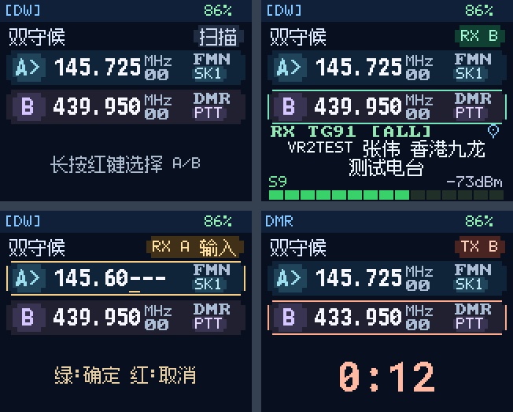
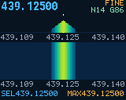

# Waterfall sweep and receive recorder fixes

[中文](SCAN_RECORDING.zh-CN.md) · [Versions](VERSIONS.md)

## VFO dual watch

VFO alternates between A and B by default on FM and DMR. The receive row highlights when a call comes in. The `>` marker identifies the VFO used for tuning, and each row shows its transmit key. C4FM and a primary VFO matched to a CPS APRS receive frequency keep single-frequency reception.

The color screen keeps both rows visible during receive, frequency entry, and transmit. It labels RX or TX during entry and shows the transmit frequency and timer during PTT. DMR calls display the received group and position pin. Short callsigns use larger centered type, and longer names wrap across two lines.
Blue identifies A and violet identifies B. The status label uses mint for reception, amber for frequency entry and warm red for transmit. Scanning and hold states use neutral colors. The last two frequency digits and MHz sit beside the larger digits.

[Light theme](screenshots/dual-watch-rc15-light.png) · Examples rendered from firmware drawing code.

| Control | Action |
| --- | --- |
| Hold RED | Select A or B as the primary VFO |
| Rotary or number keys | Pause dual watch and tune the primary VFO. Dual watch resumes about 2.5 seconds after editing and waits while digits are being entered |
| Hold SK1 alone | Transmit with A's frequency and mode. Release to stop |
| Hold physical PTT | Transmit with B's frequency and mode. Release to stop |
| Hold SK1, then hold GREEN | Toggle dual watch and save the choice |
| Hold SK1, then tap GREEN | Open the quick menu, which also has the Dual Watch toggle |
| Tap RED | Return to channel mode |

Release both keys before changing transmit routes. Each route uses the existing RX-only, band-limit and timeout checks. Dual watch uses manual hold-to-talk and suspends VOX and PTT latch. Use the VFO quick menu to choose DMR ALL or selected TG. SK1+GREEN remains available.

## Sweep

VFO long `#` enters; red exits. Since v1.1.0-alpha.2 the first sample updates the live top row immediately; a full sweep is no longer required before anything appears. Normal LCD updates transfer only the top 8-pixel strip at up to 20Hz. History shifts on row start and retains 24 rows; unsampled columns are blank.

Default **FAST uses 80 actual frequency measurements**, each represented by two adjacent pixels. **Long `*` toggles FAST/FINE**; FINE measures all 160 frequency points. Short `*` toggles stop-and-listen, which automatically uses all 160 points. While paused, `*` retains skip/resume. FAST keeps the same overall span with twice the frequency spacing; use FINE for narrow signals.

FAST waits **15 ms** after tuning before reading signal strength, reducing the 80-point dwell budget from 2 seconds to **1.2 seconds per row**. FINE and stop-and-listen still wait **25 ms**, for a 4-second dwell budget across 160 points. While the history is drawn, the receiver is already settling on the next frequency. Actual row time also depends on tuning, drawing and other tasks. The live strip updates at most once every 50 ms. Colors show normalized RSSI measured at different times across the row.

Ordinary VFO range scans tune independently of the LCD refresh. The frequency display updates at most once every 100 ms during wide scans. Narrow ranges still update on each step, and the screen updates when scanning pauses on a signal or resumes. FM and DMR retain their per-frequency dwell and signal detection settings. Reverse scans wrap to the upper limit after reaching the lower limit.

Up/down or rotary changes center; SK2 + up/down changes span. Left/right changes gain; SK2 + left/right changes floor. Center/span changes clear history rather than mix frequency axes. Existing sweep frequency-axis settings remain. History stays in CCM RAM, not Flash. Channel-list and ordinary range scans retain their entries; the waterfall replaces the VFO spectrum-bar page. No simultaneous FFT/wideband reception or background APRS/C4FM monitoring is implied.

## FM receive recorder diagnosis

| Previous behavior | v1.1 fix |
| --- | --- |
| Calls under one second discarded | 60ms minimum (three 20ms frames) |
| Last 160ms always trimmed | No tail trimming |
| Stop abandoned queued input | Drain input before final page/header |
| 8-frame/160ms queue vulnerable to Flash stalls | 32 frames/640ms; bounded two-frame catch-up per tick |
| Playback rounded down to three frames | Pad last burst with silence, retain real tail frames |
| Unclear write failure | Flash I/O ERROR, loss accounting; failed records not listed as successful |

Host tests simulate undrained stop, short calls, full/overflow queues, ring boundary playback, tail padding and read/write/erase errors. No physical Flash throughput/erase timing was measured; buffer capacity is not a guaranteed tolerable stall duration.

Limits remain: calls under 60ms are discarded, queues can overflow, power loss can lose the active recording, circular storage overwrites old data, and the list indexes at most 96 entries. C4FM experimental capture does not record. Font/pinyin banks use the last 512KiB, reducing the old recording area; back up recordings before installing resources. GPS Flash tracks remain off; waterfall/digital positions add no recording-Flash writes.

## Hardware checks

Record ten 0.2–0.8 second calls and ten 5-second calls; check count, beginning/end and playback. Record continuously for at least ten minutes, watching loss counters and I/O status; check channel changes, reopening the list and reading after reboot. Report hardware profile, version, recording mode, available space, call duration and counters. Host tests do not establish physical storage reliability or audio quality.

## Call logs and shutdown

Five-tone/DTMF entries previously erased the emulated EEPROM sector immediately, blocking audio processing. A four-entry CCM queue now preserves receive-time/frequency metadata and writes one entry per idle tick, only without reception, recording or playback. Failed entries remain queued for a five-second retry; read failures cannot turn existing slots into apparent empty space. The call-log footer reports Q (pending), D (queue overflow) and E (storage failures). Persistent call logs remain a 32-entry ring, distinct from the 96-entry recording list.

Normal software shutdown stops capture, finishes the recording tail and performs a bounded queue flush. Sudden power removal, low voltage or Flash faults can still lose pending data, and continuous reception can fill the queue. Recording remains FM-only; DMR/C4FM recording is not added. Host fault injection checks metadata preservation, idle writes, bounded retries/overflow, ring capacity, failed clear and shutdown flush.

Recording pre-erases and five-tone/DTMF log writes are deferred during sweeps, then resume on exit. Entry finishes any active recording.
