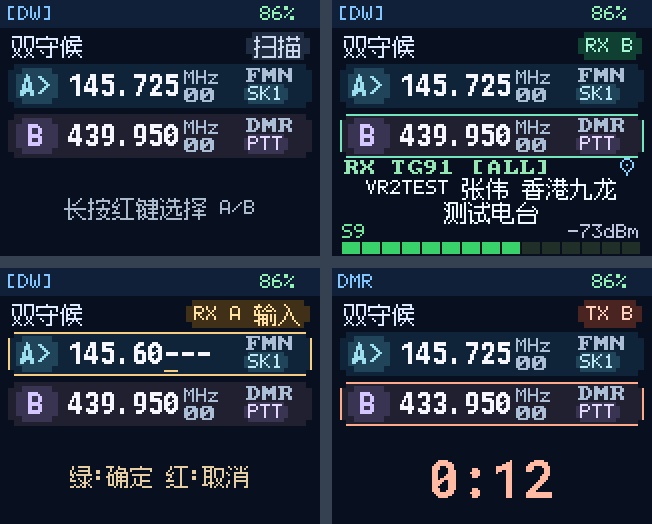
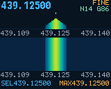

# 瀑布图扫频与接收录音修复

[English](SCAN_RECORDING.en.md) · [版本](VERSIONS.md)

## VFO 双守候

进入 VFO 后，电台默认在 A／B 两路 FM 或 DMR 间轮流守听。来话的一路会高亮，`>` 标记调频主路。每行右侧标出对应的发射键。使用 C4FM，或者主路匹配 CPS 的 APRS 接收频率时，电台保持单路接收。

彩色双守界面在接收、输入频率和发射计时期间都保留 A／B 两行。输入时标明编辑的是 RX 还是 TX，发射时实际发射的一路显示发射频率。DMR 来话显示实际组号和位置图钉，短呼号居中放大，较长的中英文姓名分两行。
蓝色 A、紫色 B。状态标签用青绿标示接收、琥珀标示频率输入、暖红标示发射，巡听和等候使用中性色。频率主体放大，末两位与 MHz 单独排列。

[浅色主题](screenshots/dual-watch-rc15-light.png) · 画面由固件绘图代码生成。

| 操作 | 功能 |
| --- | --- |
| 长按红键 | 切换 A／B 主路 |
| 旋钮或数字键 | 暂停双守并调整主路。完成操作约 2.5 秒后恢复双守，正在输入频率时继续等待 |
| 单独长按 SK1 | 用 A（第 1 路）的 TX 频率及模式发射，松开结束 |
| 按住实体 PTT | 用 B（第 2 路）的 TX 频率及模式发射，松开结束 |
| 按住 SK1，再长按绿键 | 切换双守／单守，记住选择 |
| 按住 SK1，再短按绿键 | 打开快捷菜单，也可在「双守候」切换开关 |
| 短按红键 | 返回信道模式 |

一次发射由先触发的按键控制，两键都松开后才能发下一路。两路沿用接收专用、频段限制和发射超时检查。双守页使用手动按住发射，暂停 VOX 和 PTT 锁存。双守页的 DMR ALL／指定 TG 可从 VFO 快捷菜单设置，SK1＋绿键组合保留。

## 瀑布图

VFO 长按 `#` 进入，红键退出。v1.1.0-alpha.2 起，第一点采样到达就更新顶部新行，不再收齐整行才显示；LCD 平常只更新顶部 8 像素条带，最高约 20Hz，历史在新行开始时整体下移，保留 24 行。尚未测量的列为空白，不沿用旧数据。

默认 **FAST：80 个实际频率点**，每个测量显示成相邻两像素；**长按 `*` 切换 FAST／FINE**，FINE 对 160 个频率点逐一测量。短按 `*` 开关遇信号停留监听；监听模式自动使用 160 点，暂停时 `*` 仍为跳过该频率／继续。FAST 保持相同总跨度，但频率间隔增大一倍，窄信号搜索建议 FINE。

FAST 在调谐后等待 **15 ms** 再读信号强度，80 点的驻留预算从 2 秒降到 **1.2 秒／行**。FINE 和遇信号停留监听仍等待 **25 ms**，160 点的驻留预算为 4 秒／行。绘制历史时，接收芯片已切到下一频点并开始稳定。实机每行耗时还取决于调谐、绘图和其他任务。顶部条带最快每 50 ms 更新一次。颜色表示归一化 RSSI，同一行的各点在不同时间测量。

普通 VFO 范围扫描把调谐和屏幕刷新分开。宽范围扫描中的频率显示最多每 100 ms 更新一次，窄范围仍逐步显示，信号停留和恢复扫描时及时更新。FM 与 DMR 沿用原有逐频点驻留和信号判停条件，反向扫到下限后从上限继续。

上下键／旋钮调整中心频率，SK2＋上下键调整扫描跨度；左右键调增益，SK2＋左右键调噪声底。中心或跨度改变清除旧历史，避免把不同频率轴混在一起。显示沿用原扫描轴频率设置。历史存于 CCM RAM，不写外部 Flash。信道列表扫描与普通范围扫描保留原入口；瀑布图替换原 VFO 频谱柱状页。它不提供 FFT／宽带同时接收或持续后台 APRS／C4FM 守听。

## FM 接收录音丢数据原因与修改

| 原行为 | v1.1 修改 |
| --- | --- |
| 不足 1 秒整段丢弃 | 最短 60ms（三个 20ms 帧） |
| 总是剪掉最后 160ms | 不再剪尾 |
| 停止时直接关闭，PCM 队列未消化 | 停止发布后处理完剩余输入，再写尾页和头部 |
| 8 帧／160ms 队列难以承受 Flash 擦除等待 | 32 帧／640ms；每轮最多补处理两帧 |
| 回放取三帧整数倍，最后 20–40ms 丢失 | 最后不足三帧用静音补齐，保留真实帧 |
| 写入失败无明确状态 | Flash I/O ERROR；记录丢帧计数，不将失败记录列成成功 |

主机测试模拟停止前队列未读、60ms 短通话、32 帧满队列、溢出计数、环形跨边界回放、尾帧补齐和读／写／擦除失败。没有在本机 Flash 上测得吞吐或擦除时延；缓冲上限不等于保证可阻塞 640ms。

仍有约束：短于 60ms 不保存；有限缓冲可溢出；断电中的当前录音不保证恢复；循环写满会覆盖旧数据；列表最多索引 96 条；C4FM 实验采样不能同时录音。中文字库及拼音占用最后 512KiB，原记录区已缩小，安装资源前备份所需录音。GPS Flash 轨迹默认关闭，新增瀑布图／数字位置不占用录音 Flash。

## 真机复测

连续录制十次约 0.2–0.8 秒短话和十次 5 秒语音，检查数量、开头／结尾及回放；随后录制不少于 10 分钟，观察丢帧计数与 I/O 状态。再检查跨信道记录、列表重入与重启后读取。异常请提供硬件配置、版本、录音模式、剩余空间、通话长度及计数。主机通过不能代替实际存储和音质验收。

## 日志与关机

五音／DTMF 日志原来每条立即擦写仿真 EEPROM 所在扇区，会阻塞音频处理。现在先保留接收时的时间／频率，4 条 CCM 队列等无接收、录音及回放时每轮写一条；失败保留原条目，5 秒后重试，读取失败时不把已有槽位当作空槽覆盖。日志页 `Q` 是待写条数，`D` 是队列溢出条数，`E` 是存储失败次数；队列满时不会静默丢弃。持久日志仍为 32 条循环表，录音列表为 96 条，两者不同。

正常软件关机先停止采样、完成录音尾页，再有限次数写出日志队列。突然断电、欠压或 Flash 故障仍可能失去未写内容；持续接收下队列可能满。当前录音只支持 FM，不增加 DMR／C4FM 录音。主机故障注入已验证队列、原始时间／频率、退避重试、循环容量、清除失败及关机有界写出。

扫描期间推迟录音后台预擦除和五音／DTMF 日志写入，退出扫描后恢复；进入扫描前完成当前录音收尾。
