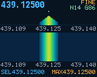

# 逐频 RSSI 瀑布图

退出双守后，在 VFO 长按 # 进入。此页独立绘制，不再经过普通 VFO 的时钟、来话和接收标记绘制路径，移动中心频率会清除旧坐标下的数据后重新扫描。

上部为正在扫描的信号强度柱线，中间和下部为完整扫描行的历史。上下刻度标出起始、中间和末端频率；底部 SEL 是光标的精确频率，MAX 是最近完整扫描中最大读数的位置。颜色由暗至蓝、绿、黄、红表示相对强度。N/G 显示底噪门限和动态范围设置，E 表示读取失败次数。

图片由生产绘图代码和字体生成，使用合成固定信号及单次尖峰干扰，不是真机 RF 数据。`python tools/ui-atlas/render_waterfall.py` 可重建。

## 操作

| 操作 | 功能 |
| --- | --- |
| 旋钮 | 移动中心频率；旧频率坐标的历史立即清除 |
| 前面板上下键 | 移动光标，底部显示对应频率 |
| 长按上键 | 光标跳到最近完整扫描的最大值 |
| SK2＋上下键或 SK2＋旋钮 | 调整扫描跨度 |
| SK1＋上下键 | 调整底噪门限 N |
| SK1＋旋钮 | 调整动态范围 G |
| 绿键 | 试听光标频率，再按恢复扫描 |
| 短按 * | 开关 AUTO 自动停下试听；试听中按 * 跳过当前频率 |
| 长按 * | 切换快速/精细扫描，并退出 AUTO |
| 数字输入 | 输入八位中心频率；如 43912500 表示 439.12500MHz。输入中红键取消 |
| 红键 | 退出瀑布图，恢复正常模式、频率和节电等级 |

手动试听持续到再次按绿键或退出。AUTO 试听沿用信号确认、通话保持和超时恢复；自动试听使用精细采样。当前只能试听 FM 音频，扫描期间保留原信道配置并使用 FM 窄带测量，退出后恢复原模式。

## 数据处理与边界

每个测量点先调谐并至少驻留 20ms，再间隔 5ms 读取三次有效 RSSI，取中值，减少单次尖峰影响。快速模式实际测量 80 点，每点占两个像素；精细模式测量 160 点。理想计时分别为 2.4s/4.8s，实际时间还包含调谐、I2C 和 LCD 开销。

读取失败和硬件频段外的位置显示为空；失败时不使用上一频点缓存。只有完整扫完且取得有效读数的行进入历史，试听打断的半行不冒充完整历史。换中心/跨度会重置坐标及历史；调节 N/G 会开始新历史，避免混用颜色比例。

这是逐频 RSSI 测量，分辨能力受接收前端带宽限制。噪声仍会有正常波动；MAX 表示最大读数，不证明那里是有效通信信号。

`python3 tests/run_waterfall_scan_tests.py`（Linux/WSL、GCC、ASan/UBSan）使用生产频率映射、采样状态机、绘图和按键函数，检查三次读数的中值、寄存器失败、频段边缘、整行滚动、未采样数据留空、按下/释放事件、光标/试听/数字输入、计时回绕及禁止时钟覆盖。实机仍需用已知频率的稳定信号验证峰值位置、噪声表现、调频连续性和试听恢复。
