# 界面图谱 · 帮助与信息

[返回操作手册目录](../MANUAL.zh-CN.md#manual-toc)

共 63 幅。编号用于识别菜单，画面来自固件界面重建。

|   |   |   |
| --- | --- | --- |
| 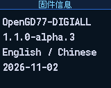 M24 · 版本 / 编译信息 | 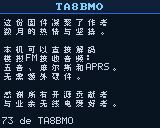 M24 · 作者说明 | 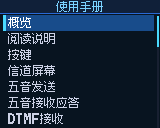 M56 · 主题列表 · 1/4 |
| 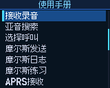 M56 · 主题列表 · 2/4 | 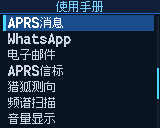 M56 · 主题列表 · 3/4 | 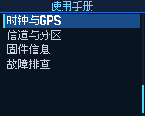 M56 · 主题列表 · 4/4 |
| 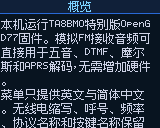 M56 · 概览 · 1/2 | 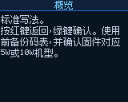 M56 · 概览 · 2/2 | 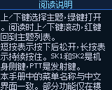 M56 · 阅读说明 · 1/2 |
| 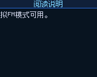 M56 · 阅读说明 · 2/2 | 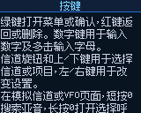 M56 · 按键 · 1/2 | 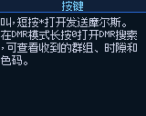 M56 · 按键 · 2/2 |
| 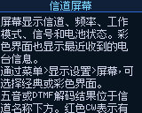 M56 · 信道屏幕 · 1/2 | 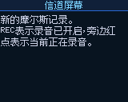 M56 · 信道屏幕 · 2/2 | 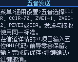 M56 · 五音发送 · 1/2 |
| 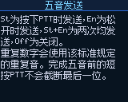 M56 · 五音发送 · 2/2 | 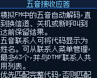 M56 · 五音接收应答 · 1/3 | 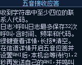 M56 · 五音接收应答 · 2/3 |
|  M56 · 五音接收应答 · 3/3 | 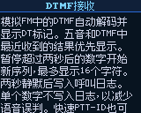 M56 · DTMF接收 · 1/2 | 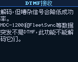 M56 · DTMF接收 · 2/2 |
| 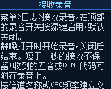 M56 · 接收录音 · 1/4 | 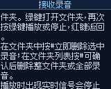 M56 · 接收录音 · 2/4 | 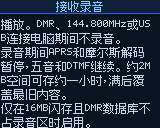 M56 · 接收录音 · 3/4 |
|  M56 · 接收录音 · 4/4 | 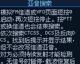 M56 · 亚音搜索 · 1/2 |  M56 · 亚音搜索 · 2/2 |
| 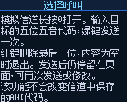 M56 · 选择呼叫 · 1/2 |  M56 · 选择呼叫 · 2/2 | 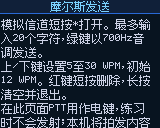 M56 · 摩尔斯发送 · 1/2 |
| 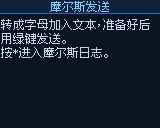 M56 · 摩尔斯发送 · 2/2 | 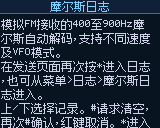 M56 · 摩尔斯日志 · 1/2 | 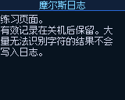 M56 · 摩尔斯日志 · 2/2 |
| 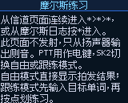 M56 · 摩尔斯练习 · 1/2 | 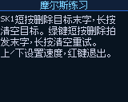 M56 · 摩尔斯练习 · 2/2 | 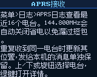 M56 · APRS接收 · 1/3 |
| 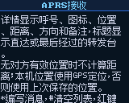 M56 · APRS接收 · 2/3 | 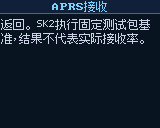 M56 · APRS接收 · 3/3 | 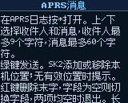 M56 · APRS消息 · 1/2 |
| 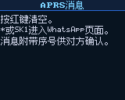 M56 · APRS消息 · 2/2 | 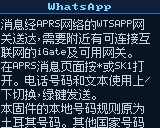 M56 · WhatsApp · 1/2 | 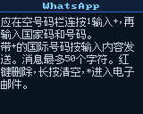 M56 · WhatsApp · 2/2 |
| 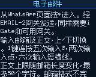 M56 · 电子邮件 · 1/2 | 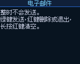 M56 · 电子邮件 · 2/2 | 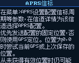 M56 · APRS信标 · 1/3 |
| 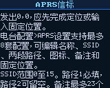 M56 · APRS信标 · 2/3 | 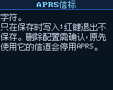 M56 · APRS信标 · 3/3 | 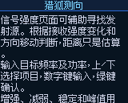 M56 · 猎狐测向 · 1/2 |
| 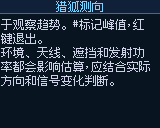 M56 · 猎狐测向 · 2/2 | 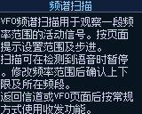 M56 · 频谱扫描 · 1/2 |  M56 · 频谱扫描 · 2/2 |
| 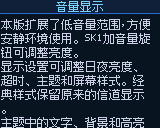 M56 · 音量显示 · 1/2 | 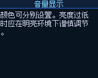 M56 · 音量显示 · 2/2 | 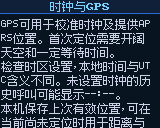 M56 · 时钟与GPS · 1/2 |
| 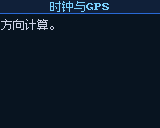 M56 · 时钟与GPS · 2/2 |  M56 · 信道与分区 · 1/3 |  M56 · 信道与分区 · 2/3 |
|  M56 · 信道与分区 · 3/3 |  M56 · 固件信息 · 1/2 |  M56 · 固件信息 · 2/2 |
|  M56 · 故障排查 · 1/3 |  M56 · 故障排查 · 2/3 |  M56 · 故障排查 · 3/3 |
