# 界面图谱 · 解码与日志

[返回操作手册目录](../MANUAL.zh-CN.md#manual-toc)

共 29 幅。编号用于识别菜单，画面来自固件界面重建。

|   |   |   |
| --- | --- | --- |
| 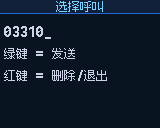 M40 · 输入五音代码 | 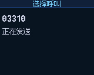 M40 · 正在发送 | 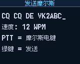 M41 · 输入 / PTT电键 |
| 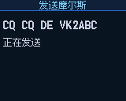 M41 · 正在发送 | 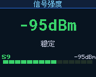 M42 · 强度 / 峰值辅助 | 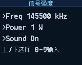 M42 · 频率 / 功率输入 |
| 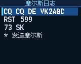 M50 · 记录列表 | 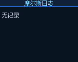 M50 · 空记录 |  M50 · 清空确认 |
| 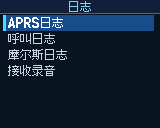 M51 · 日志中心 | 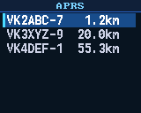 M51 · APRS电台列表 | 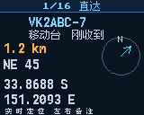 M51 · APRS电台卡片 |
| 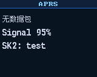 M51 · APRS空列表 / 诊断 | 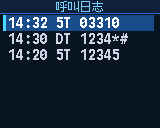 M51 · 呼叫日志列表 | 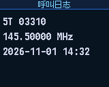 M51 · 呼叫详情 |
| 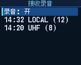 M51 · 录音文件夹 | 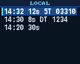 M51 · 文件夹内录音 | 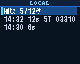 M51 · 录音播放 |
| 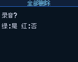 M51 · 删除录音确认 | 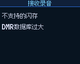 M51 · 录音不可用 | 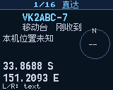 M51 · APRS位置无本机定位 |
| 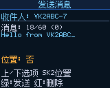 M52 · 编辑并发送消息 | 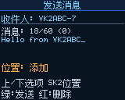 M52 · 附带本机位置 | 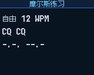 M53 · 自由练习 |
| 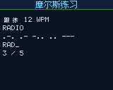 M53 · 跟练 | 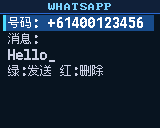 M54 · APRS转WhatsApp | 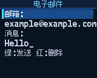 M55 · APRS转电子邮件 |
| 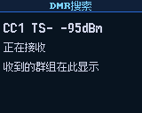 M58 · 监听中 | 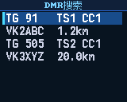 M58 · 已收到群组 |  |
