# 界面图谱 · 菜单与联系人

[返回操作手册目录](../MANUAL.zh-CN.md#manual-toc)

共 11 幅。编号用于识别菜单，画面来自固件界面重建。

|   |   |   |
| --- | --- | --- |
| 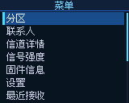 M00 · 主菜单 · 1/2 | 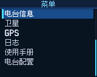 M00 · 主菜单 · 2/2 | 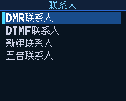 M01 · 联系人菜单 |
| 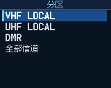 M02 · 选择分区 | 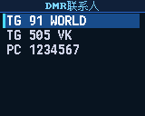 M13 · DMR联系人列表 | 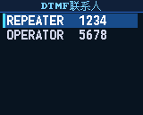 M14 · DTMF联系人列表 |
| 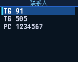 M15 · 快捷联系人列表 | 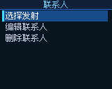 M16 · 联系人操作 | 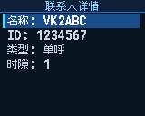 M17 · 编辑联系人 |
| 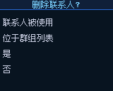 M17 · 删除确认 / 被引用提示 | 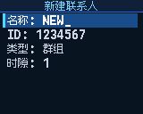 M37 · 新建DMR联系人 |  |
