# 界面图谱 · 日常收发

[返回操作手册目录](../MANUAL.zh-CN.md#manual-toc)

共 48 幅。编号用于识别菜单，画面来自固件界面重建。

|   |   |   |
| --- | --- | --- |
| 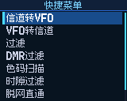 M21 · 信道快捷菜单 · 1/2 |  M21 · 信道快捷菜单 · 2/2 | 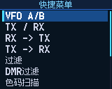 M22 · VFO快捷菜单 · 1/2 |
| 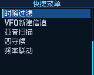 M22 · VFO快捷菜单 · 2/2 |  M26 · 确认 / 警告对话框 | 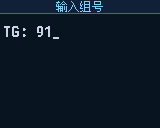 M29 · 输入组号 |
| 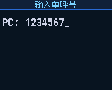 M29 · 输入单呼号 | 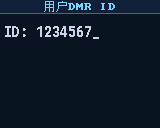 M29 · 输入本机DMR ID | 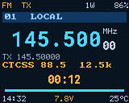 M30 · FM发射 |
| 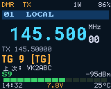 M30 · DMR发射 | 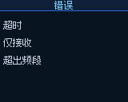 M30 · 超时 / 仅接收 / 越界提示 | 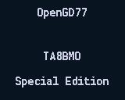 M31 · 默认开机文字 |
|  M32 · 关机画面 | 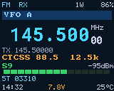 M33 · VFO A | 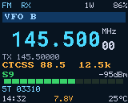 M33 · VFO B |
| 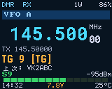 M33 · DMR VFO | 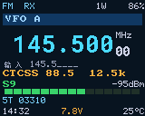 M33 · 输入频率 | 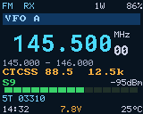 M33 · 扫描范围输入 |
| 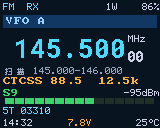 M33 · 范围扫描 | 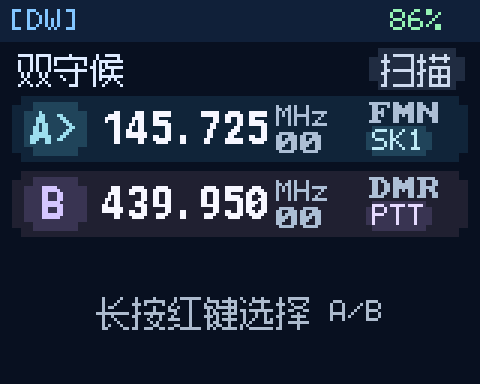 M33 · 双守巡听 | 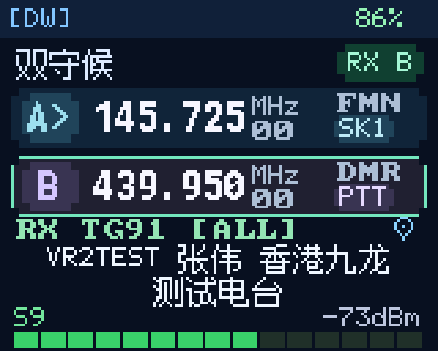 M33 · 数字来话与实际组号 |
| 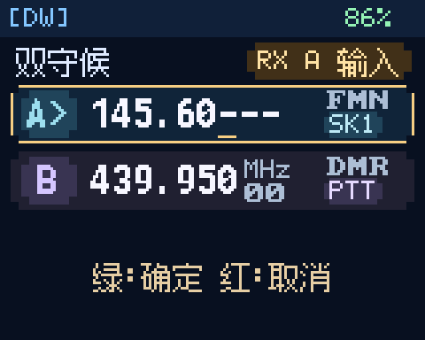 M33 · 编辑 A 路 | 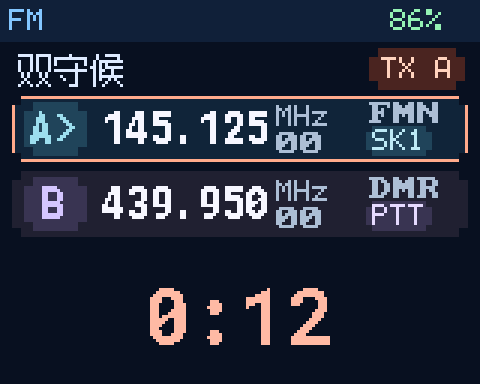 M33 · 长按 SK1 发 A | 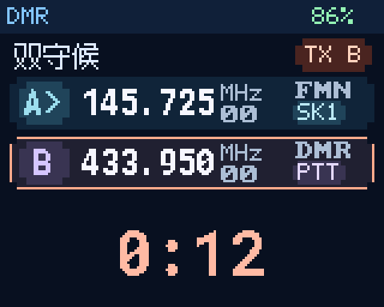 M33 · 实体 PTT 发 B |
| 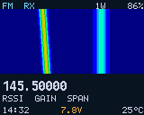 M33 · 瀑布图扫描 | 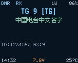 M33 · DMR VFO中央大字来电 | 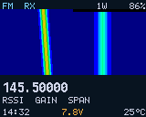 M33 · 瀑布图实时扫描行 |
|  M34 · FM彩色信道 | 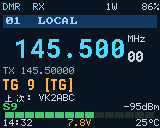 M34 · DMR彩色信道 | 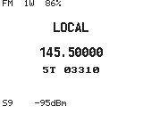 M34 · 经典信道 |
| 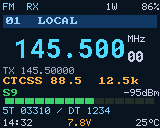 M34 · 五音/DTMF接收结果 | 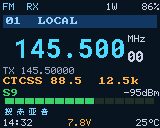 M34 · 亚音搜索叠加 | 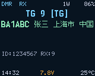 M34 · DMR中央大字来电 |
| 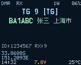 M34 · DMR接收位置 | 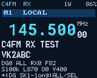 M34 · C4FM接收诊断（开发构建） | 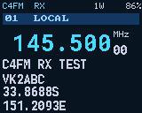 M34 · C4FM接收位置 |
| 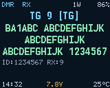 M34 · DMR长名称第一页 |  M34 · DMR长名称第二页 | 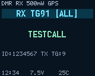 M34 · DMR ALL 实际接收组号 |
| 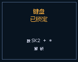 M35 · 键盘锁定 / 解锁 | 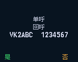 M36 · 收到DMR单呼 | 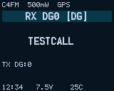 C4FM DN 日常主屏 |
| 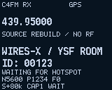 Wires-X 查询等待 | 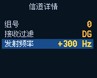 C4FM TX 微调 | 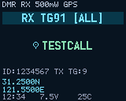 DMR 位置图钉 |
| 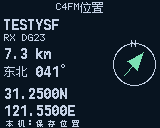 C4FM 位置指南针 | 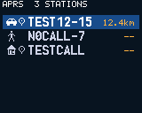 APRS 位置图钉 | 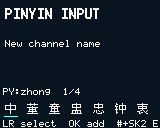 原生中文拼音输入 |
