# 界面图谱 · 信息与定位

[返回操作手册目录](../MANUAL.zh-CN.md#manual-toc)

共 19 幅。编号用于识别菜单，画面来自固件界面重建。

|   |   |   |
| --- | --- | --- |
| 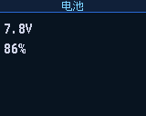 M03 · 电池 | 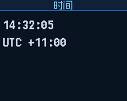 M03 · 时间 | 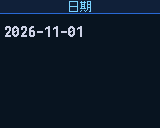 M03 · 日期 |
| 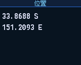 M03 · 位置 | 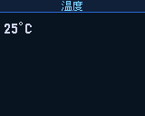 M03 · 温度 | 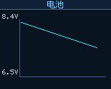 M03 · 电池历史曲线 |
|  M03 · 运行时间 | 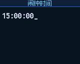 M03 · 闹钟时间 | 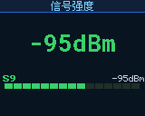 M04 · 信号监测 |
| 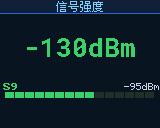 M04 · 无信号 | 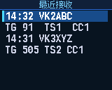 M05 · 最近接收电台 | 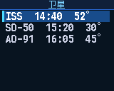 M11 · 全部过境预测 |
| 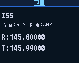 M11 · 所选卫星 | 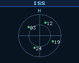 M11 · 极坐标轨迹 | 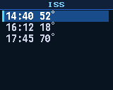 M11 · 单颗卫星过境预测 |
| 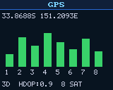 M12 · 卫星信号与坐标 |  M12 · 卫星天空图 | 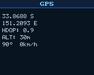 M12 · 方向 / 速度 / 海拔 |
| 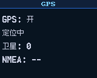 M12 · 默认开启与等待定位 |  |  |
