# 界面图谱 · 电台配置

[返回操作手册目录](../MANUAL.zh-CN.md#manual-toc)

共 24 幅。编号用于识别菜单，画面来自固件界面重建。

|   |   |   |
| --- | --- | --- |
| 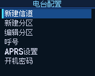 M57 · 配置总菜单 | 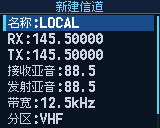 M57 · 新建信道 · 1/2 | 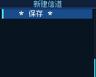 M57 · 新建信道 · 2/2 |
| 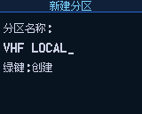 M57 · 新建分区 | 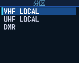 M57 · 分区选择 | 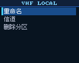 M57 · 分区操作 |
| 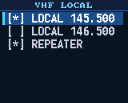 M57 · 增删分区信道 | 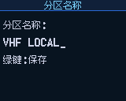 M57 · 重命名分区 | 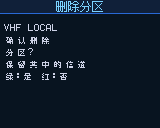 M57 · 删除分区确认 |
| 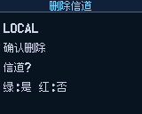 M57 · 删除信道确认 | 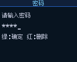 M57 · 密码验证 | 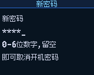 M57 · 设置新密码 |
| 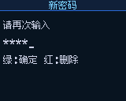 M57 · 再次输入密码 | 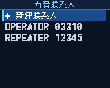 M57 · 五音联系人列表 | 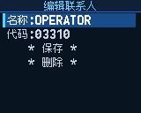 M57 · 五音联系人编辑 |
| 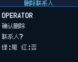 M57 · 删除五音联系人 | 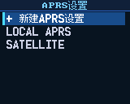 M57 · APRS配置列表 | 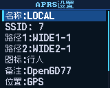 M57 · APRS配置编辑 · 1/2 |
| 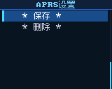 M57 · APRS配置编辑 · 2/2 | 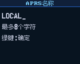 M57 · APRS名称输入 | 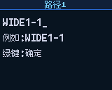 M57 · 转发路径输入 |
| 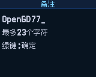 M57 · 备注输入 | 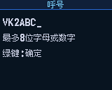 M57 · 呼号输入 | 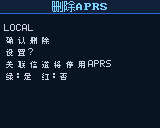 M57 · 删除APRS配置确认 |
