# 界面图谱 · 设置

[返回操作手册目录](../MANUAL.zh-CN.md#manual-toc)

共 30 幅。编号用于识别菜单，画面来自固件界面重建。

|   |   |   |
| --- | --- | --- |
| 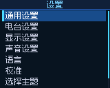 M06 · 设置总菜单 · 1/2 |  M06 · 设置总菜单 · 2/2 | 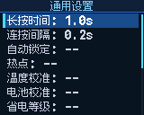 M07 · 通用设置 · 1/2 |
| 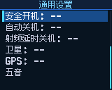 M07 · 通用设置 · 2/2 | 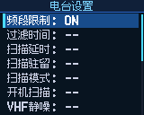 M08 · 电台设置 · 1/3 | 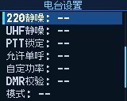 M08 · 电台设置 · 2/3 |
| 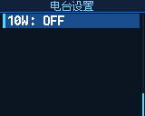 M08 · 电台设置 · 3/3 | 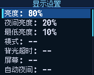 M09 · 显示设置 · 1/3 | 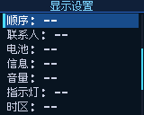 M09 · 显示设置 · 2/3 |
| 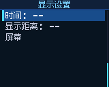 M09 · 显示设置 · 3/3 | 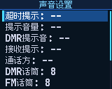 M10 · 声音设置 · 1/2 | 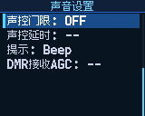 M10 · 声音设置 · 2/2 |
|  M18 · 界面语言 | 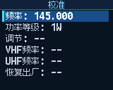 M19 · 校准 | 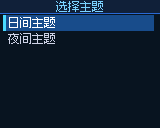 M20 · 日间 / 夜间主题 |
| 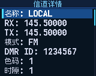 M23 · 信道详情与参数 · 1/5 | 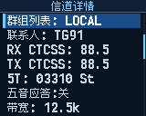 M23 · 信道详情与参数 · 2/5 | 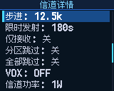 M23 · 信道详情与参数 · 3/5 |
| 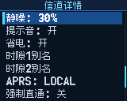 M23 · 信道详情与参数 · 4/5 |  M23 · 信道详情与参数 · 5/5 | 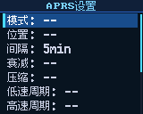 M25 · APRS设置 · 1/2 |
| 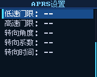 M25 · APRS设置 · 2/2 | 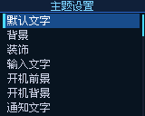 M38 · 主题元素浏览 · 1/5 | 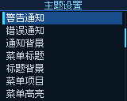 M38 · 主题元素浏览 · 2/5 |
| 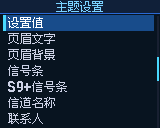 M38 · 主题元素浏览 · 3/5 | 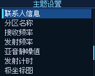 M38 · 主题元素浏览 · 4/5 | 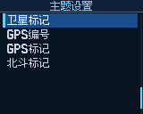 M38 · 主题元素浏览 · 5/5 |
| 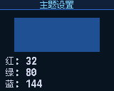 M39 · RGB值和预览 | 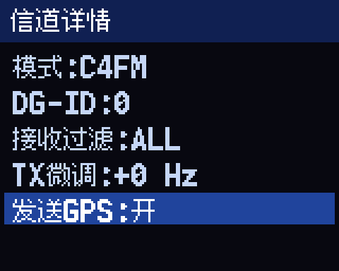 C4FM GPS 发送设置示意 | 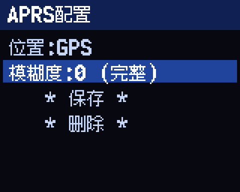 APRS 位置模糊度设置示意 |
