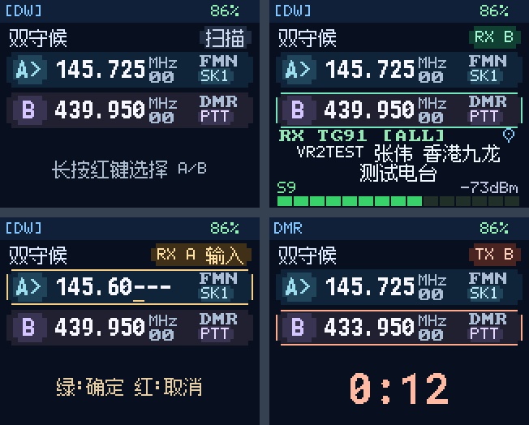

# v1.2.0-rc.15 · 双守候与分路发射 / Dual watch and A/B transmit

**本版署名 / Release credit · VRWZI / BIAOQ**

FM／DMR VFO 默认轮听 A／B。新版同屏显示频率、模式和发射键。蓝色对应 A，紫色对应 B，青绿对应来话，琥珀对应频率输入，暖红对应发射。频率主体放大，DMR 来话仍可显示实际组号、位置图钉和两行姓名。

- **长按 SK1 发 A，按住实体 PTT 发 B。** 路由与调频选中的 A／B 无关。松开两键后可换路。双守期间暂停 VOX 和 PTT 锁存。
- **长按红键选调频主路。** 转动旋钮或输入频率时暂时暂停轮听，操作完约 2.5 秒恢复。按住 SK1 再长按绿键，可切换单守／双守。
- DMR 双守从 VFO 快捷菜单选择 ALL／指定 TG。C4FM 和当前主路受保护的 APRS 接收采用单路接收。

支持双段 MD-UV380／MD-UV390 的 **5W＋GPS、Plus 10W PD8、Plus 10W PC6**。已装本项目当前字库、拼音的电台只刷对应的 `03`。首次安装依次刷 `01 → 02 → 03`。三个板型均启用 C4FM DN 主屏收发，两种 10W 待上机确认。

[完整中文手册（Word）](https://github.com/xunyu5800-alt/OpenGD77-DIGIALL-Testing/releases/download/v1.2.0-rc.15/OpenGD77_DIGIALL_Manual_ZH_CN_v1.2.0-rc.15.docx) · [双守候按键与图例](https://github.com/xunyu5800-alt/OpenGD77-DIGIALL-Testing/blob/v1.2.0-rc.15/docs/SCAN_RECORDING.zh-CN.md)

## English

FM and DMR VFO now alternate between A and B by default. The redesigned screen shows both frequencies, modes and transmit keys. Blue and violet identify A and B. Mint marks reception, amber marks frequency entry and warm red marks transmit. DMR calls continue to show the received group, position pin and up to two lines of caller text.

- **Hold SK1 to transmit on A. Hold physical PTT to transmit on B.** The transmit route is independent of the tuning selection. Release both keys before changing routes. Dual watch suspends VOX and PTT latch.
- **Hold RED to select the tuning VFO.** Tuning or entering digits pauses the watch. It resumes about 2.5 seconds after editing. Hold SK1, then hold GREEN to toggle single/dual watch.
- Use the VFO quick menu to choose DMR ALL or selected TG in dual watch. C4FM and protected APRS reception on the primary VFO use single-frequency reception.

Packages cover dual-band MD-UV380/MD-UV390 **5W+GPS, Plus 10W PD8 and Plus 10W PC6**. Flash the matching Stage 03 if current project font and pinyin resources are installed. A first install uses Stages 01 through 03 in order. All builds enable main-screen C4FM DN RX/TX. Both 10W boards still need on-radio testing.

[Dual-watch controls and visuals](https://github.com/xunyu5800-alt/OpenGD77-DIGIALL-Testing/blob/v1.2.0-rc.15/docs/SCAN_RECORDING.en.md)

三个板型均已编译，双守候界面图由固件绘图代码生成。欢迎复测 FM／DMR 双守的 A／B 发射、编辑后恢复轮听，以及浅色与深色主题在实际屏幕上的辨识度。

All three board profiles were built. The screenshots come from firmware drawing code. Radio feedback is welcome on A/B transmit routing, resuming dual watch after editing, and readability in both themes.

